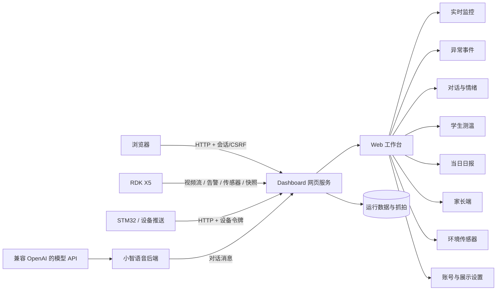
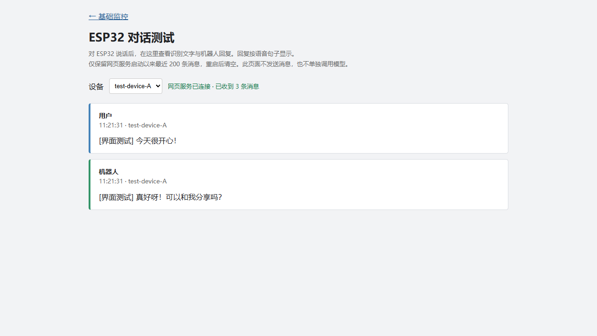

# 童域智枢：网页监控与语音交互软件

## 1. 项目简介

本仓库是“童域智枢”项目的网页可视化与语音交互软件，负责监控信息展示、统一异常事件处置、对话与情绪分析、学生测温与当日日报、家长端安全事件查看，以及 RDK/STM32/ESP32 设备数据接口接入。设备通信与数据字段沿用团队先期联调确认过的接口，网页的信息架构、布局、样式和交互在本课程仓库中独立设计和实现。

### 项目边界与依赖关系

本仓库负责网页展示、设备数据接口接入及语音交互服务集成。RDK 视觉识别、STM32 传感器采集、ESP32 设备固件和机器人运动控制由独立模块实现；它们通过约定接口向本软件提供数据，不属于本仓库的源码范围，也不作为本仓库的软件实现内容。

### 开发基线与验证边界

团队在先期实际设备联调中已确认以下传输链路能够工作：

- RDK 的视频流与行为状态能够传到 Dashboard。
- STM32 的体温、环境温湿度、eCO₂ 和 TVOC 字段能够被服务端接收和解析。
- ESP32 能够连接小智语音服务，对话文字能够转发到 Dashboard。

这里的“已确认”是指设备传输、服务端接收和字段解析曾完成联调，不代表本仓库的隔离测试重新测量了传感器精度，也不代表所有网络环境下都不会出现连接问题。V1 自动化测试使用隔离的上游响应检查网页路由、字段处理、访问限制和消息持久化；实际设备联调结果作为本次网页开发的接口基线。详细说明见 [API 文档](docs/API.md) 和 [验证记录](docs/VALIDATION.md)。

本地目录 `tongyu-zhishu-v1` 是上述 GitHub 课程仓库在开发电脑上的工作副本。Git 的远端地址只决定从哪里拉取、向哪里推送，不能说明代码或设计思路来自哪里；项目来源与复用范围应以本节、提交历史和第三方来源说明为准。

## 2. 功能概览

| 模块 | 可以做什么 |
| --- | --- |
| 实时监控 | 看 RDK 摄像头画面、设备连接状态和摔倒／斗殴提示。查看红外目标温度、红外环境温度、室温、湿度、eCO₂ 和 TVOC，页面标注采集时间、过期和离线状态。 |
| 异常事件 | 筛选并回看告警，查看详情、备注和处置记录。列表每 5 秒静默刷新，提示新告警和待处理超时。监控页读取到新的 RDK 摔倒或斗殴告警时，后台保存事件并尝试抓拍；环境传感器断开、数据过期、eCO₂/TVOC 超限由后台监控自动建事件并去重。配置播报地址后，摔倒/斗殴事件会异步推送并记录播报结果。事件详情可打开原图供老师复核，管理员可标记已处理或误报。 |
| 对话与情绪 | 接收 ESP32 小智的识别文字和机器人回复，按北京时间的日期、设备和会话查看最近 200 条消息，支持搜索和情绪线索回顾。管理员可修改界面和模型配置，删除当前会话或确认清空全部对话及摘要。 |
| 学生测温 | 管理员可导入名单、登记体温及复测。可按日期、班级和学生筛选，并导出 CSV。登记栏默认显示实时红外目标温度，管理员选学生后确认保存，也可切换测量来源手动录入。设备携带令牌推送已关联学生的有效稳定读数时，可自动登记。 |
| 当日日报 | 按日期和班级汇总异常事件处置、测温完成情况及需留意对话，支持打印。正在查看当天数据时，跨日会更新到新一天。 |
| 人物估算（实验） | 管理员可在监控视频下方开启，利用本机姿态模型估算疑似成人、疑似儿童和未确定人数。默认关闭，启用需要单独准备模型和依赖。 [人物估算说明](docs/PERSON_TYPE_DEMO.md) |

用户自行注册后进入待分配状态。管理员在「账号管理」为已注册账号分配角色。家长绑定学生后按权限查看孩子的安全事件和个人日报，商家查看环境传感器读数，演示账号使用单独的展示设置。老师关联事件时从名单选择学生，并可为该事件单独开放截图。详见 [家长端安全事件](docs/FAMILY_EVENTS.md)。

账号、展示设置、告警、抓拍、对话和测温记录保存在运行网页服务的电脑上。同一服务下，手机和电脑可按各自权限查看同一份记录。重启网页后，用户用原账号重新登录即可。

## 3. 系统软件架构



仓库目录：

```text
dashboard/          网页、业务接口、RDK/传感器代理与运行数据
xiaozhi-server/      小智 Python 后端及对话消息转发
scripts/            本地初始化、环境检查和提交检查
tests/              网页接口与消息转发自动化测试
docs/               API、二次开发、协作和验证文档
```

## 4. 技术栈与实现原理

- Python 3.10：运行 Dashboard HTTP 服务和小智后端。
- HTML/CSS/JavaScript：实现监控、事件、对话、测温、日报、家长端等页面和定时数据刷新。
- HTTP 接口：接入视频流、行为状态、环境数据、设备推送和对话消息。
- WebSocket：由小智后端承载语音交互会话。
- 异步消息队列：对话消息在后台转发，避免网页处理影响语音服务。
- 本地记录文件：事件、抓拍、对话、名单与体温、账号和展示设置均保存在被 Git 忽略的运行时文件，使用原子写入；事件与对话有条数上限。
- 账号与权限：管理员、演示、家长、商家和待分配账号按角色进入不同页面，业务写接口要求同源、CSRF 和管理员会话。

Dashboard 将上游接口转换为同源网页接口；浏览器只访问 Dashboard。小智后端在处理用户文字和回复句子时，将消息异步发送到 Dashboard，对话页按配置的间隔读取并展示。页面仅显示记录，不发送消息，也不单独调用对话模型。

## 5. 网页效果展示

可查看 [实时监控和事件页](docs/assets/monitor-events-live.png)、[学生测温页](docs/assets/health-page-live.png) 与 [当日日报](docs/assets/reports-page-live.png) 的界面示例。

### 对话记录页



访问地址：<http://127.0.0.1:8088/chat>。页面展示用户消息、机器人回复、时间、设备和会话信息，支持筛选、搜索和界面设置。对话数据与设置只保存在运行服务的电脑中。

### 基础监控页

访问地址：<http://127.0.0.1:8088/>。页面包含监控画面、行为状态和六项传感器数据，并提供对话测试页入口。

## 6. 下载后快速运行

下列电脑端命令以 Windows 为例，在下载并解压后的项目根目录执行。先按需要选择运行范围。

| 想使用的功能 | 需要准备 |
| --- | --- |
| 打开网页、登录、管理名单和已有记录 | Python 3.10、网页依赖、首次创建管理员 |
| 看实时视频、行为状态和传感器 | 再启动 RDK 端程序，并填写 RDK 实际地址 |
| 使用 ESP32 小智语音 | 再配置本机模型 API，安装完整语音依赖和模型文件，并把 ESP32 指向电脑的小智服务 |
| 使用模型情绪分析 | 需要有效的本机模型 API 配置。网页的本地词库模式可直接使用 |
| 生成手机外网链接 | 另备 cloudflared。 [手机演示指南](docs/MOBILE_DEMO.md) |

### 6.1 首次启动网页

电脑安装 Python 3.10 后，在 PowerShell 中运行以下命令。如果 `py` 不可用且 `python --version` 显示 3.10，可用 `python -m venv .venv` 创建环境。

```powershell
py -3.10 -m venv .venv
.\.venv\Scripts\python.exe -m pip install -r dashboard/requirements.txt
$env:RDK_BASE = "http://192.168.43.54:5000"
.\.venv\Scripts\python.exe scripts/run_dashboard.py
```

首次启动时按终端提示创建管理员，再打开 <http://127.0.0.1:8088/login>。网页注册的新账号由管理员分配角色。**仅运行网页时，API Key 可以留空。** 电脑尚未连上 RDK 时，网页仍可登录和管理本机已有记录，实时区域会提示设备不可用。

### 6.2 提前启动 RDK，提供实时数据

把电脑和 RDK 连到彼此可达的网络。在电脑终端 SSH 登录 RDK，之后在 RDK 终端进入程序目录并启动：

```bash
ssh root@192.168.43.54
cd /root/wheeltec_fall_detect
python3 web_fall.py
```

上述地址和目录是现有设备的示例。使用其他 RDK 时，把 SSH 地址及网页的 `RDK_BASE` 都改成对应设备地址，目录按 RDK 上的部署位置填写。**RDK 上需要提前部署 `wheeltec_fall_detect` 程序、模型和依赖，并连接摄像头及传感器。** SSH 终端运行期间保持程序运行，电脑端 Dashboard 会从 RDK 的 `5000` 端口读取数据。

启动后可在电脑浏览器打开 `http://192.168.43.54:5000/alert_status` 和 `http://192.168.43.54:5000/api/iot_payload`。前者应返回行为状态 JSON，后者应返回传感器连接状态、采集时间和读数。测温页读取 RDK 实时数据时可以直接使用此接口。设备主动推送及自动登记需要配置设备令牌，见 [实时红外测温说明](docs/HEALTH_REPORT_UI.md#102-设备推送接口)。抓拍依赖 RDK 提供的 `/snapshot`。如两个 JSON 接口都打不开，先核对 RDK IP、网络和 RDK 终端报错。

### 6.3 启用小智语音

安装 Git 后，在 Conda 终端进入项目根目录。下列命令创建带 Python 3.10、FFmpeg 和 Opus 的语音环境。语音依赖中有从 GitHub 安装的包，安装时需要联网。

```powershell
conda create -n tongyu-voice -c conda-forge python=3.10 ffmpeg libopus
conda activate tongyu-voice
python -m pip install -r requirements.txt
python scripts/setup_local.py
```

初始化脚本会创建本机的 `xiaozhi-server/data/.config.yaml`，已有配置时会保留。打开这个文件，在 `LLM → DeepSeekLLM` 下填写自己申请的 `api_key`、服务 `url` 和该密钥可用的 `model_name`。真实密钥只填本机配置。使用 DeepSeek 官方 API 时，示例模板里的旧模型名 `deepseek-chat` 需要改成当前支持的模型名，例如 `deepseek-flash`。使用其他兼容服务时，三项按该服务的配置配套填写。 [DeepSeek API 配置说明](https://api-docs.deepseek.com/)

在同一文件的 `server.websocket` 中填入服务电脑的局域网地址，例如 `ws://192.168.43.236:8000/xiaozhi/v1/`，再让 ESP32 连接到实际地址。这里填**运行小智的电脑 IP**，RDK 的 IP 用于网页的 `RDK_BASE`。

如果 ESP32 固件通过 OTA 获取连接地址，把固件的 OTA 地址指向这台电脑的 `http://<电脑局域网IP>:8003/xiaozhi/ota/`。可在电脑或同网段手机打开该地址，核对返回的 WebSocket 地址。

将 SenseVoiceSmall 和 Silero 模型目录放到以下位置。可复制团队已验证的模型目录，或从模型发布方获取对应文件。

- 语音识别放在 `xiaozhi-server/models/SenseVoiceSmall/`，保留模型配置、分词器和 `model.pt`。 [SenseVoiceSmall 模型文件](https://huggingface.co/FunAudioLLM/SenseVoiceSmall/tree/main)
- 语音活动检测所用的 ONNX 文件放在 `xiaozhi-server/models/snakers4_silero-vad/src/silero_vad/data/silero_vad.onnx`。 [Silero VAD 发布页](https://github.com/snakers4/silero-vad/releases)

在项目根目录执行 `python scripts/check_runtime.py` 可检查 Python 模块、FFmpeg、配置文件和模型文件。文件清单包含联调时的示例文件和字节数，可用于比对模型目录。API Key 的有效性需要在实际调用时确认。 [模型文件清单](docs/model-files.json)

保持网页服务运行，在另一个已激活语音环境的终端启动小智：

```powershell
cd xiaozhi-server
python app.py
```

ESP32 连上小智后，对话文字会转发到同一台电脑上的 Dashboard。网页默认端口为 `8088`，小智设备连接默认用 `8000`。修改了网页端口时，需要同步调整小智的 `DIALOGUE_DASHBOARD_URL`。

### 6.4 用 VS Code 一键启动

安装 Python 和 Python Debugger 扩展，用 VS Code 打开项目根目录，选择已安装所需依赖的 Python 解释器。首次参考 [启动模板](docs/vscode-launch.example.json)，复制为本地的 `.vscode/launch.json`，已有启动配置时按需合入。

在“运行和调试”中选择“启动网页服务”或“同时启动全部服务”，按 F5 并输入实际 RDK 地址。选择带“手机分享”的启动项时，可在终端看到临时 HTTPS 登录链接。RDK 端仍按上面的步骤单独启动。

## 7. API 文档

本仓库提供以下网页服务接口：

| 方法 | 地址 | 用途 |
|---|---|---|
| GET | `/api/rdk/video_feed` | 代理监控视频流 |
| GET | `/api/rdk/status` | 读取行为状态 |
| GET | `/api/rdk/sensors` | 读取环境和体温数据 |
| POST | `/api/dialogue/messages` | 接收小智后端的对话消息 |
| GET | `/api/dialogue/messages` | 获取最近 200 条对话消息 |
| GET/POST | `/api/dialogue/config` | 读取或保存对话界面设置 |
| POST | `/api/dialogue/delete` | 管理员删除会话记录或清空对话 |
| GET | `/health` | 获取 Dashboard 服务状态 |
| GET | `/api/auth/session` | 获取登录状态与 CSRF 验证信息 |
| POST | `/api/auth/register`、`/api/auth/login`、`/api/auth/logout` | 注册、登录、退出 |
| GET/POST | `/api/admin/policy` | 管理员读取或保存展示权限 |
| GET | `/api/config` | 登录后读取 RDK 配置地址 |
| GET/POST | `/api/events` | 查询事件或由管理员创建事件 |
| GET | `/api/events/{id}/snapshot` | 查看有权限访问的告警抓拍 |
| POST | `/api/events/{id}/status`、`/api/events/{id}/notes` | 管理员处置事件、保存备注 |
| POST | `/api/events/{id}/participants` | 管理员按姓名关联事件参与学生 |
| GET | `/api/health/students`、`/api/health/records` | 查询名单和测温记录 |
| GET | `/api/health/realtime` | 查看实时红外读数 |
| POST | `/api/health/device-readings` | 接收携带设备令牌的红外读数 |
| POST | `/api/health/import`、`/api/health/records` | 管理员导入名单、登记体温 |
| GET | `/api/reports/daily` | 查询按权限过滤的日报 |
| GET/POST | `/api/admin/accounts`、`/api/admin/parents` | 管理员管理账号角色与家长绑定 |
| GET | `/api/family/events`、`/api/family/events/{id}` | 家长读取绑定孩子的安全事件 |
| GET | `/api/family/events/{id}/snapshot` | 家长读取获授权的事件截图 |
| GET | `/api/family/daily`、`/api/family/students` | 家长读取孩子日报与绑定学生 |
| GET | `/api/merchant/sensors` | 商家读取环境传感器字段 |

完整请求字段、返回结构和异常状态见 [API 文档](docs/API.md)。

## 8. 二次开发指南

新增监控组件、数据字段、交互页面和后端接口时，可分别扩展：

- `dashboard/index.html`：监控页面结构与刷新逻辑。
- `dashboard/events.html`、`dashboard/family-events.html`：事件处置页和家长端页面。
- `dashboard/chat.html`、`dashboard/health.html`、`dashboard/reports.html`：对话、测温与日报页面。
- `dashboard/server.py`：网页路由、上游接口代理、事件/测温/日报业务和数据校验。
- `dashboard/access_control.py`：账号、角色、家长绑定与展示设置。
- `xiaozhi-server/core/utils/dialogue_monitor.py`：对话消息转发。

具体扩展步骤见 [二次开发指南](docs/EXTENDING.md)。

## 9. 测试与验证

```bat
python -m pip install -r tests/requirements.txt
python -m unittest discover -s tests -v
python scripts\verify_repository.py
```

当前自动化测试共 103 项，覆盖登录权限与角色、RDK 数据代理、事件抓拍与家长可见性、对话删除、测温及日报接口、传感器字段过滤和消息写入与转发。浏览器检查覆盖页面渲染和设备筛选。详细结果及软件限制见 [验证记录](docs/VALIDATION.md)。

## 10. 团队开发与开源说明

只有执行 `git commit` 才会产生提交记录，执行 `git push` 后 GitHub 才会显示。三位成员应使用各自的 GitHub 账号和分支提交本人完成的工作，通过 Pull Request 合并，具体流程见 [团队协作说明](docs/DEVELOPMENT.md)。

小智后端来源、导入版本和修改范围见 [第三方来源](THIRD_PARTY.md)。上游小智代码保留其 MIT 许可证。本仓库目前为团队私人协作仓库；公开发布前，应由团队共同确定新增网页代码的许可证，并检查文档、图片和依赖的发布授权。
