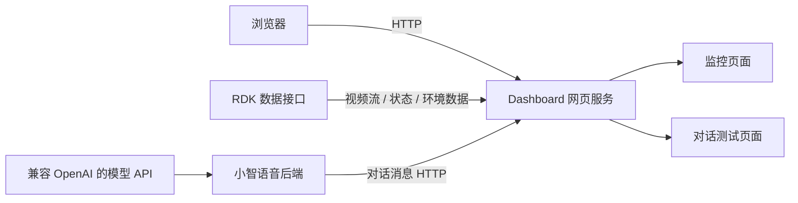

# 童域智枢：网页监控与语音交互软件

## 1. 项目简介

本仓库是“童域智枢”项目的网页可视化与语音交互软件，负责监控信息展示、行为状态提示、环境数据展示和对话消息查看。项目基于已有软件接口进行集成与二次开发。

### 项目边界与依赖关系

本仓库负责网页展示、设备数据接口接入及语音交互服务集成。RDK 视觉识别、STM32 传感器采集、ESP32 设备固件和机器人运动控制由独立模块实现；它们通过约定接口向本软件提供数据，不属于本仓库的源码范围，也不作为本仓库的软件实现内容。

## 2. 功能概览

- 监控画面：在浏览器中展示上游视频流。
- 行为提示：展示正常、摔倒和斗殴等识别状态。
- 环境数据：展示体温、环境温湿度、eCO₂ 和 TVOC。
- 对话测试：按设备查看用户识别文字和机器人回复。
- 模型配置：提供脱敏的大模型接口模板和儿童陪伴提示词。
- 网页扩展基础：为后续事件处置、情绪分析和更多管理页面保留服务端接口结构。

## 3. 系统软件架构



仓库目录：

```text
dashboard/          网页、RDK 数据代理和对话消息接口
xiaozhi-server/      小智 Python 后端及对话消息转发
scripts/            本地初始化、环境检查和提交检查
tests/              网页接口与消息转发自动化测试
docs/               API、二次开发、协作和验证文档
```

## 4. 技术栈与实现原理

- Python 3.10：运行 Dashboard HTTP 服务和小智后端。
- HTML/CSS/JavaScript：实现监控页、对话页和定时数据刷新。
- HTTP 接口：接入视频流、行为状态、环境数据和对话消息。
- WebSocket：由小智后端承载语音交互会话。
- 异步消息队列：对话消息在后台转发，避免网页处理影响语音服务。
- 内存消息缓存：网页服务保留最近 200 条对话消息，重启后清空。

Dashboard 将上游接口转换为同源网页接口；浏览器只访问 Dashboard。小智后端在处理用户文字和回复句子时，将消息异步发送到 Dashboard，对话页每秒读取并按设备筛选展示。

## 5. 网页效果展示

### 对话测试页


访问地址：<http://127.0.0.1:8088/chat>。页面展示用户消息、机器人回复、接收时间和设备编号，并支持设备筛选。

### 基础监控页

访问地址：<http://127.0.0.1:8088/>。页面包含监控画面、行为状态和六项传感器数据，并提供对话测试页入口。

## 6. 快速部署

使用 Windows CMD 或 Anaconda Prompt。Python 依赖环境为 `xiaozhi-esp32-server`。

### 6.1 本地配置

网页服务本身只使用 Python 标准库。完整语音交互服务使用 Python 3.10、根目录 `requirements.txt` 中的依赖和 FFmpeg。首次克隆后执行：

```bat
cd /d D:\ESP32\tongyu-zhishu-v1
conda activate xiaozhi-esp32-server
pip install -r requirements.txt
python scripts\setup_local.py
```

仓库不上传真实 API Key 和模型权重。在 `xiaozhi-server/data/.config.yaml` 中填写模型 API Key；模型接口、模型名称和儿童陪伴提示词模板已经提供。语音服务使用的 SenseVoiceSmall 和 Silero 模型放入 `xiaozhi-server/models`，所需文件见 [模型文件清单](docs/model-files.json)。

### 6.2 启动语音交互服务

```bat
cd /d D:\ESP32\tongyu-zhishu-v1\xiaozhi-server
conda activate xiaozhi-esp32-server
python app.py
```

### 6.3 启动网页服务

```bat
cd /d D:\ESP32\tongyu-zhishu-v1\dashboard
conda activate xiaozhi-esp32-server
set RDK_BASE=http://192.168.43.54:5000
python server.py
```

`RDK_BASE` 是网页服务使用的数据接口地址，地址变化时只修改启动参数。PowerShell 对应写法为：

```powershell
$env:RDK_BASE="http://192.168.43.54:5000"
python server.py
```

## 7. API 文档

本仓库提供以下网页服务接口：

| 方法 | 地址 | 用途 |
|---|---|---|
| GET | `/api/rdk/video_feed` | 代理监控视频流 |
| GET | `/api/rdk/status` | 读取行为状态 |
| GET | `/api/rdk/sensors` | 读取环境和体温数据 |
| POST | `/api/dialogue/messages` | 接收小智后端的对话消息 |
| GET | `/api/dialogue/messages` | 获取最近 200 条对话消息 |
| GET | `/health` | 获取 Dashboard 服务状态 |

完整请求字段、返回结构和异常状态见 [API 文档](docs/API.md)。

## 8. 二次开发指南

新增监控组件、数据字段、交互页面和后端接口时，可分别扩展：

- `dashboard/index.html`：监控页面结构与刷新逻辑。
- `dashboard/chat.html`：对话页面和筛选逻辑。
- `dashboard/server.py`：网页路由、上游接口代理和数据校验。
- `xiaozhi-server/core/utils/dialogue_monitor.py`：对话消息转发。

具体扩展步骤见 [二次开发指南](docs/EXTENDING.md)。

## 9. 测试与验证

```bat
python -m unittest discover -s tests -v
python scripts\verify_repository.py
```

当前自动化测试覆盖网页路由、RDK JSON 代理、消息格式校验、本机访问限制、设备消息顺序、重复消息、缓存上限和转发异常隔离。浏览器检查覆盖页面渲染和设备筛选。详细结果及软件限制见 [验证记录](docs/VALIDATION.md)。

## 10. 团队开发与开源说明

只有执行 `git commit` 才会产生提交记录，执行 `git push` 后 GitHub 才会显示。三位成员应使用各自的 GitHub 账号和分支提交本人完成的工作，通过 Pull Request 合并，具体流程见 [团队协作说明](docs/DEVELOPMENT.md)。

小智后端来源、导入版本和修改范围见 [第三方来源](THIRD_PARTY.md)。上游小智代码保留其 MIT 许可证。本仓库目前为团队私人协作仓库；公开发布前，应由团队共同确定新增网页代码的许可证，并检查文档、图片和依赖的发布授权。
