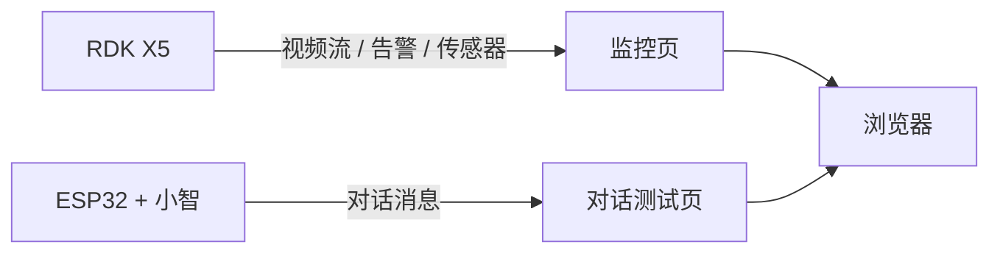
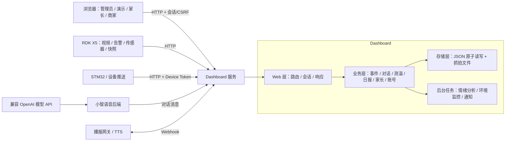
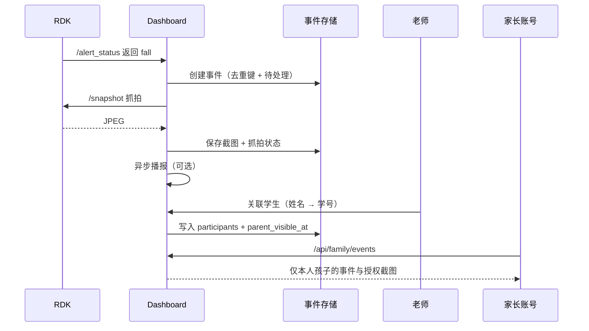

# 系统架构说明

更新日期：2026-11-05

## 1. 重构前（基线 `c499217`）

开题时的基线是“两个独立页面”的分离式原型：

- 只有 4 个 `dashboard` 文件，`server.py` 172 行；
- 监控页负责展示，对话页只做记录查看；
- 没有统一事件、名单体温、日报、账号权限，也没有测试和 CI。

## 2. 重构后（当前 `main`）

### 模块职责

| 文件 | 职责 | 备注 |
|---|---|---|
| `dashboard/server.py` | HTTP 路由、会话与 CSRF、业务编排、存储调用 | 当前集中式 Web/业务层（约 2800 行） |
| `dashboard/event_contract.py` | 事件字段、枚举、校验、日报映射 | 领域契约 |
| `dashboard/analysis.py` | 本地词库/模型情绪分析、会话摘要、模型配置 | 策略模式 |
| `dashboard/access_control.py` | 账号、角色、家长绑定、会话、限流 | 领域服务 |
| `dashboard/health_realtime.py` | 红外读数归一化与新鲜度判断 | 适配层 |
| `dashboard/person_type_runtime.py` | 可选人物估算进程管理 | 可选实验 |
| `dashboard/*.html` | 监控、事件、对话、测温、日报、家长、传感器、管理页面 | 表现层 |
| `dashboard/access.js` / `access.css` | 会话导航、权限显示、共享样式 | 前端共享资源 |
| `xiaozhi-server/` | ESP32 语音会话、ASR/TTS/LLM 接入 | 上游 MIT 代码 |

### 关键流程：摔倒告警到家长端

### 数据与存储

| 数据 | 路径（运行时可覆盖） | 上限 / 策略 |
|---|---|---|
| 事件 | `dashboard/events.json` | 2000 条，按 `dedupe_key` 去重 |
| 抓拍 | `dashboard/event_snapshots/` | 随事件清理，单张 ≤ 2 MiB |
| 对话 | `dashboard/dialogue_messages.json` | 200 条 |
| 会话摘要 | `dashboard/conversation_summaries.json` | 按会话保存 |
| 名单/体温 | `dashboard/health_students.json`、`health_records.json` | 导入校验、按学号关联 |
| 账号/展示设置 | `dashboard/auth_config.json` | scrypt 哈希、角色与家长绑定 |
| 模型/分析配置 | `dashboard/analysis_config.json`、`xiaozhi-server/data/.config.yaml` | 密钥脱敏 |

所有运行文件均被 `.gitignore` 排除，写入使用临时文件 + `os.replace` 原子替换。

## 3. 部署视图

| 组件 | 默认地址 | 说明 |
|---|---|---|
| Dashboard | `http://127.0.0.1:8088` | 网页、API、抓拍 |
| 小智后端 | `ws://<电脑IP>:8000/xiaozhi/v1/` | ESP32 语音会话 |
| 小智 OTA | `http://<电脑IP>:8003/xiaozhi/ota/` | 设备获取连接地址 |
| RDK | `http://192.168.43.54:5000` | 视频、告警、传感器、快照 |
| 手机分享 | cloudflared 临时 HTTPS | 可选，见 `docs/MOBILE_DEMO.md` |

## 4. 界面示例

- 监控与事件页：`docs/assets/monitor-events-live.png`
- 学生测温页：`docs/assets/health-page-live.png`
- 当日日报：`docs/assets/reports-page-live.png`
- 家长端：`dashboard/family-events.html`

## 5. 已知限制与演进方向

1. Web 层与业务层仍集中在 `server.py`；后续可按
   `web/`、`services/`、`repositories/` 拆分，并保留现有 HTTP 契约。
2. 存储为 JSON 运行时文件；如需并发编辑或大数据量查询，可在仓储接口后增加
   SQLite 实现（开题中的备选方案）。
3. 环境与设备事件依赖 Dashboard 进程；若要独立采集，可增加守护进程或由
   STM32 网关推送。
4. 抓拍依赖 RDK `/snapshot`；旧设备回退到视频流抓帧，时间语义已在
   [验证记录](VALIDATION.md) 中说明。
