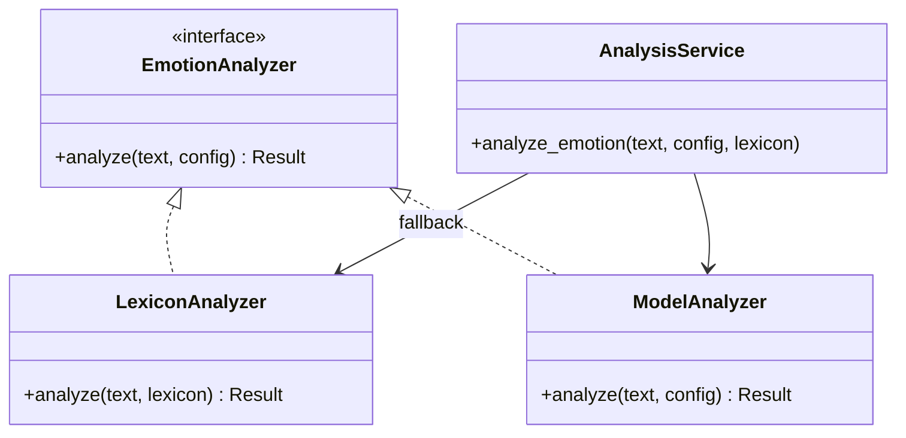
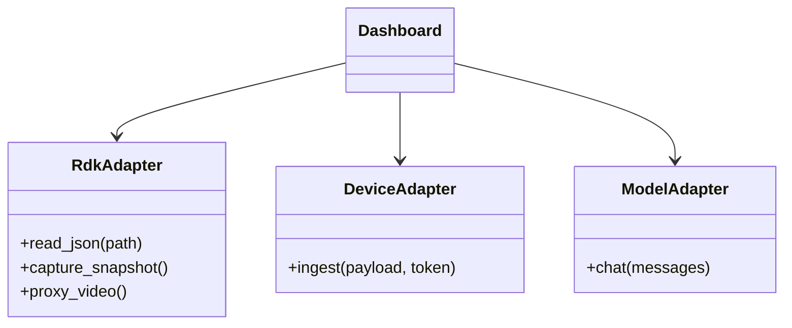
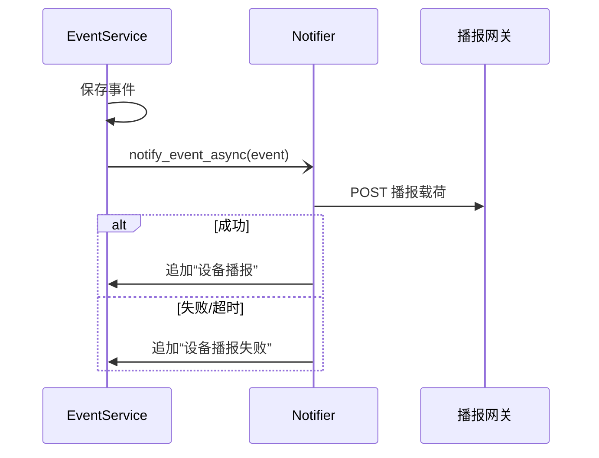
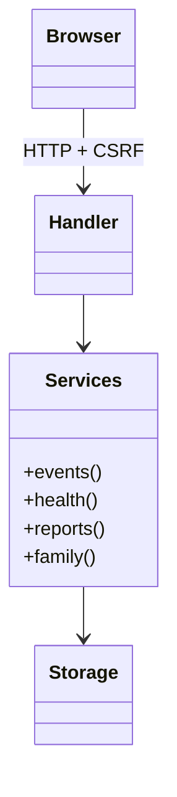

# 设计模式与重构说明

更新日期：2026-11-05

本项目在重构中使用了策略、适配器、观察者式通知、外观和工厂等设计思路。
当前数据落盘依赖共用的 JSON 原子读写工具，仓储接口是后续演进方向。
UML 图表示职责和调用关系，代码位置见表格。

## 1. 模式总览

| 模式 | 解决的问题 | 代码位置 | 效果 |
|---|---|---|---|
| Strategy 策略 | 情绪分析可在本地词库与模型之间切换、失败回退 | `dashboard/analysis.py` 的 `analyze_lexicon` / `analyze_emotion` | 更换分析方式不改调用方；记录 `source` |
| Adapter 适配器 | RDK、STM32、小智、模型 API 的协议差异 | `read_rdk_json`、`capture_event_snapshot`、`xiaozhi-server/core/providers/*` | 页面只依赖同源 HTTP；上游变化局部化 |
| Observer 观察者 | 事件保存后通知播报通道，失败不影响主流程 | `notify_event_async` → `deliver_event_notification` | 通知与事件解耦，结果写入处理记录 |
| Facade 外观 | 前端只面对一个同源服务与统一 JSON 契约 | `dashboard/server.py` 的 Handler / 路由 | 页面不直连设备与模型 |
| Factory 工厂 | 生成稳定、可追溯的事件编号 | `event_contract.make_event_id` | 编号规则集中，便于日志与排查 |
| Repository 仓储（规划） | 将业务与文件路径和存储实现隔离 | 当前由 `json_storage.py` 提供 JSON 读写 | 已共用底层读写，业务仓储接口尚未抽离 |

## 2. 策略模式：双模式情绪分析

实际代码中两者是函数，通过配置和失败回退选择；`Result.source` 记录本次实际使用
的模式（`lexicon`、`model`、`lexicon-fallback`），便于追溯与统计。

## 3. 适配器模式：设备与模型接入

- RDK 的 `/video_feed`、`/alert_status`、`/api/iot_payload`、`/snapshot` 被封装为
  同源接口；
- 设备推送通过 `X-Device-Token` 与浏览器会话隔离；
- 小智后端用统一的模型提供方接口适配 OpenAI 兼容服务。

## 4. 观察者模式：事件通知

通知在后台线程执行，失败只记录处理历史，不影响事件入库；未配置 `ALERT_NOTIFY_URL`
时完全跳过。

## 5. 外观模式：统一 Web 工作台

页面只访问同源 `/api/*`，由 Handler 完成会话、权限、参数校验和响应封装；前端
不直接访问 RDK、STM32 或模型 API。

## 6. 工厂与仓储

- `make_event_id` 统一生成 `EVT-YYYYMMDD-XXXXXX`，日志、抓拍文件名和日报都以
  事件编号关联；
- `json_storage.py` 管理临时文件、原子替换和占用重试。事件容量和文件路径仍由
  `server.py` 管理。
- 演进方向：定义 `EventRepository` 协议（`list/find/add/replace`），JSON 与 SQLite
  各实现一份，业务层只依赖协议。

## 7. 重构效果（定性）

| 维度 | 重构前 | 现在 |
|---|---|---|
| 设备接入 | Dashboard 已代理 RDK，页面主要展示上游状态 | 代理结果进一步进入统一事件、设备异常和抓拍流程 |
| 异常处理 | 仅页面颜色/提示 | 统一事件契约、状态流转、证据与处理记录 |
| 情绪分析 | 无 | 策略切换 + 回退 + 来源记录 + 自动事件 |
| 通知 | 无 | 观察者式异步播报，失败可追溯 |
| 权限 | 无 | 角色、模块、家长绑定、截图授权 |
| 测试 | 6 项 | 112 项 + CI + 仓库自检 |

量化数据与前后对比见 [重构效果量化](EXPERIMENTS.md)。
