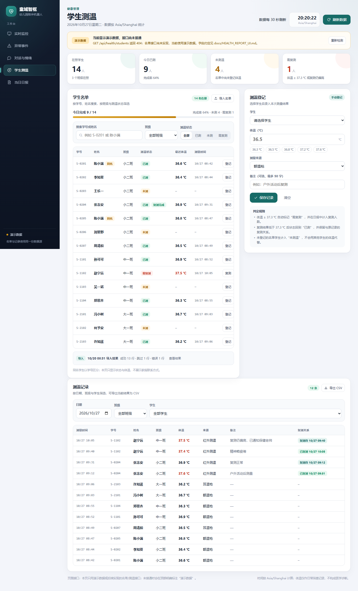
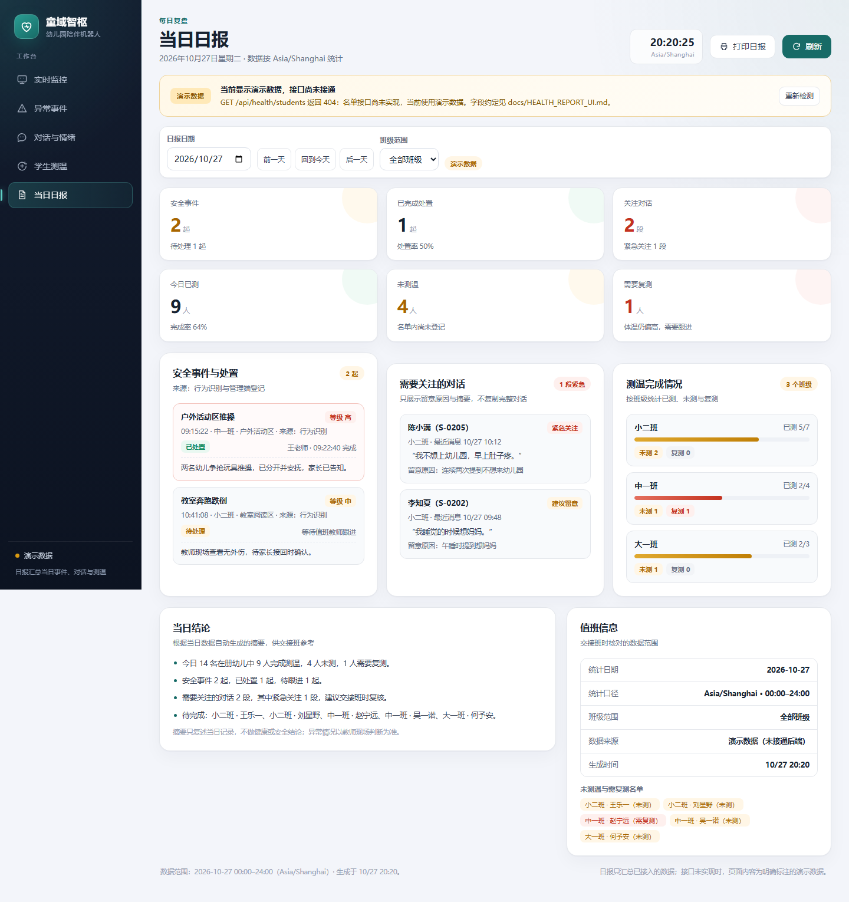
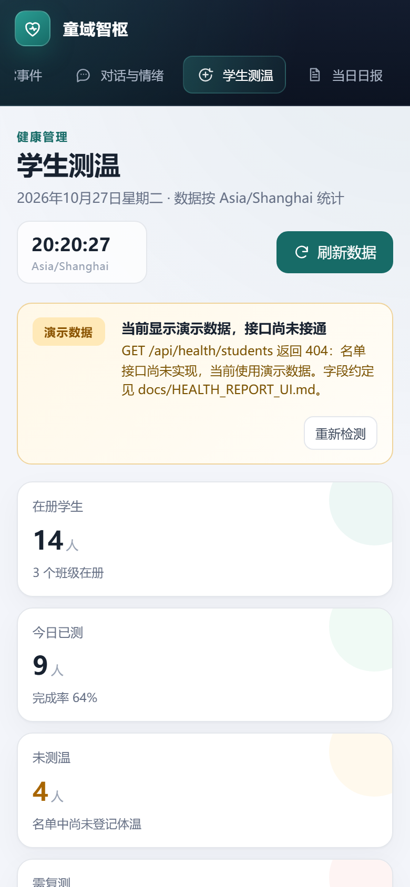
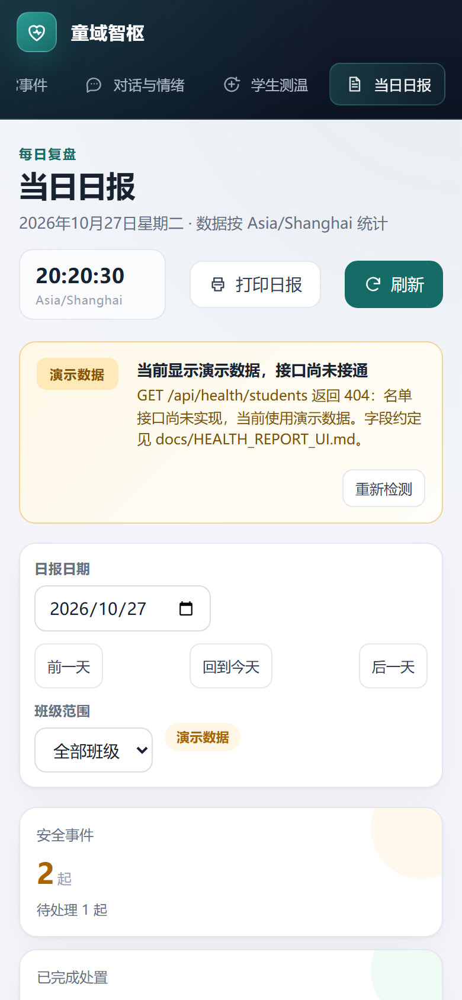
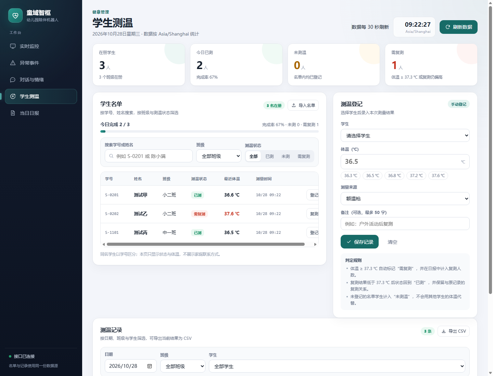
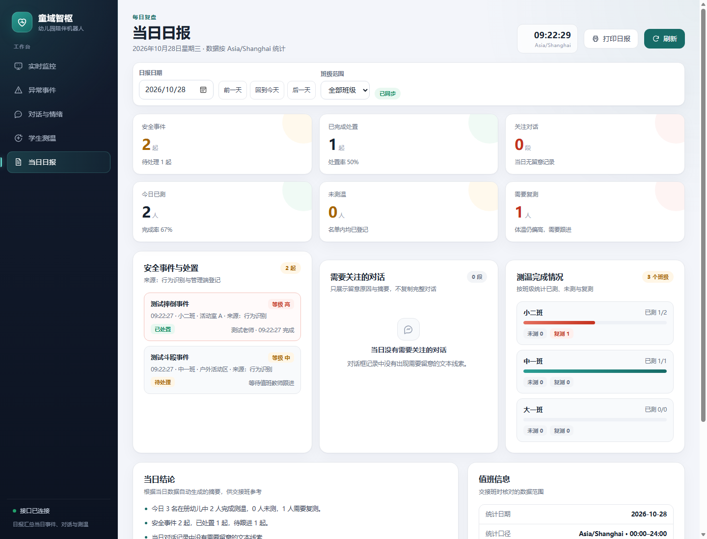

# 学生测温与当日日报页面

更新日期：2026-10-27

本文件说明成员 C 负责的两页：`dashboard/health.html`（学生测温）和 `dashboard/reports.html`（当日日报），包括页面结构、交互规则、状态处理、已实现接口的字段约定、测试与浏览器检查记录。

## 1. 页面与文件

| 文件 | 作用 |
|---|---|
| `dashboard/health.html` | 学生测温页：名单搜索与筛选、体温登记、测温记录、CSV 导出、名单导入 |
| `dashboard/reports.html` | 当日日报页：日期与班级范围切换、事件处置、关注对话、测温完成情况、打印 |
| `dashboard/health-report.css` | 两页共用的样式：设计令牌、侧边导航、卡片、表格、表单、弹窗和响应式断点 |
| `dashboard/health-report.js` | 两页共用的脚本：接口访问、演示数据、状态判定、筛选、导入校验与 CSV 导出 |
| `tests/test_health_report.py` | 路由、公共导航、演示标识、接口约定与接口可用状态的自动化检查 |

访问地址（需要先启动 Dashboard 服务）：

```text
http://127.0.0.1:8088/health.html
http://127.0.0.1:8088/reports.html
```

侧边导航的五个入口与 `dashboard/index.html` 完全一致：实时监控、异常事件、对话与情绪、学生测温、当日日报。两页的导航项、配色、卡片、筛选栏、空状态和错误提示沿用监控页改版后的设计令牌，保证三个人页面风格统一。

## 2. 学生测温页

### 2.1 页面结构

1. **概览卡片**：在册学生、今日已测、未测温、需复测四个数字，以及完成率进度条。
2. **学生名单**：显示学号、姓名、班级、测温状态、最近体温与测量时间，可直接对某名学生登记或复测。
3. **筛选栏**：按学号或姓名搜索、按班级筛选、按“全部 / 已测 / 未测 / 需复测”切换。
4. **测温登记**：选择学生、输入体温、选择测量来源、填写备注，必要时把本次测量标记为复测。
5. **测温记录**：按日期、班级和学生筛选，显示时间、体温、来源、备注与复测关系，并可导出 CSV。日期筛选只影响记录表与导出；名单、概览和登记始终按今天统计，避免把历史日期误当成“今日完成”。
6. **导入名单**：读取 CSV，在浏览器内逐行校验，显示成功行数、跳过行数，以及错误行号、原因和原始内容。

页面跨天或从后台回到前台时，如果用户没有手动选择历史日期，会自动切换到 Asia/Shanghai 的今天并重新读取数据；手动选择的历史日期不会被强行改掉。

### 2.2 状态判定规则

- 当天没有任何记录：`未测`。
- 当天最后一条记录 `< 37.3 ℃`：`已测`；若该学生当天先有偏高记录、随后完成复测且复测正常，额外显示“复测完成”。
- 当天最后一条记录 `≥ 37.3 ℃`：`需复测`。
- 复测关系通过 `recheck_of` 指向原记录：原记录显示“已复测 时间”，复测记录显示“复测自 时间”。
- 未登记的名单学生不会被其他学生的体温覆盖，也不会被自动填成正常。

### 2.3 输入校验

| 场景 | 处理 |
|---|---|
| 未选择学生 | 阻止提交，学生下拉框标红并聚焦 |
| 体温为空或不是数字 | 阻止提交，体温输入框标红并提示示例 |
| 体温不在 35.0–42.0 ℃ | 阻止提交，提示“超范围数值不会被保存”，记录数不变 |
| 备注超过 50 字 | 输入框限制 `maxlength=50`，脚本再次校验 |
| 重复点击保存 | 保存期间按钮禁用，避免重复记录 |
| 查看历史日期时登记 | 新记录属于“现在”，保存后自动切回今天并刷新，避免记录落在历史日期视图中 |
| 同名学生 | 名单与下拉框都显示学号，并给重名学生加“同名”标记 |

### 2.4 导入校验

CSV 表头需要包含 `学号, 姓名, 班级`（UTF-8，允许存在其他列）。逐行校验：

- 学号必填，格式为 3–20 位字母、数字或连字符；
- 姓名必填，最多 20 个字符；
- 班级必须与现有班级同名；
- 同一文件内学号重复记为错误行；
- 学号已存在于名单时计入“跳过”，不算错误。

错误行在弹窗中以“行号 / 原因 / 原始内容”表格列出；关闭弹窗后，名单卡片底部保留最近一次导入结果摘要，可再次打开查看。

### 2.5 CSV 导出

导出当前筛选结果，文件名为 `测温记录_YYYY-MM-DD.csv`，编码为带 BOM 的 UTF-8（Excel 直接打开不乱码），列为：

```text
日期, 时间, 学号, 姓名, 班级, 体温(℃), 来源, 备注, 复测关系
```

## 3. 当日日报页

1. **日期与班级范围**：日期默认今天（Asia/Shanghai），可用前一天 / 回到今天 / 后一天切换；班级范围支持全部或单个班级。
2. **关键数字**：安全事件、已完成处置、关注对话、今日已测、未测温、需要复测，共六项。
3. **安全事件与处置**：时间、班级、地点、等级、状态、处置人、处置时间和备注；待处理事件醒目标注。
4. **需要关注的对话**：只显示学生、留意等级、留意原因、最近消息时间和一句摘要，不复制完整对话。
5. **测温完成情况**：按班级显示已测 / 总数、进度条以及未测、复测人数。
6. **当日结论**：根据当日数据自动生成 3–4 条摘要，供交接班参考；摘要只复述记录，不做健康或安全结论。
7. **值班信息**：统计日期、统计口径、班级范围、数据来源和生成时间，并列出未测温与需复测名单。
8. **打印日报**：`window.print()`，打印样式隐藏导航、筛选栏和按钮，只保留报告内容。

## 4. 四种状态与“演示数据”标识

| 状态 | 页面表现 |
|---|---|
| 加载中 | 表格显示占位行，卡片显示 `--`；首次进入时顶部提示“正在检查数据接口” |
| 空数据 | 名单为空、筛选无结果、当天无测温记录、日报当日无数据，分别使用独立的空状态文案 |
| 接口错误 | 顶部红色提示条显示 HTTP 状态或超时原因；名单与记录清空并提示“接口异常”，保留“重新检测”入口 |
| 接口不可用 | 接口返回 403/404/502 或超时时进入演示模式，顶部提示标注“演示数据”和原因，侧边栏状态显示“演示数据”，日报“数据来源”写明“演示数据（未接通后端）” |

演示数据规则：

- 演示名单、体温、事件与对话是固定样例，人物均为虚构；不包含真实学生、家长联系方式和真实体温。
- 演示模式下的登记、导入只改变当前页面内存，**不会写入服务器**，导入结果会明确显示“演示模式：未写入后端”。
- 直接双击打开 HTML 文件时没有 Dashboard 服务，页面按演示模式渲染，并提示改用 `http://127.0.0.1:8088/health.html`。
- 真实接口接通后（`GET /api/health/students` 返回 200），提示条自动隐藏，页面改用接口数据，不需要改页面代码。

## 5. 已实现接口与契约

以下接口已经实现，页面优先读取真实接口；接口不可用时才使用演示数据。字段与页面一致，详细请求/响应见 `docs/API.md`。

**实现记录**：学生名单、测温记录和当日日报接口已接入本机 Dashboard，运行时文件被 Git 忽略。

**建议标签**：`enhancement`、`dashboard`、`api`、`成员C`

### 5.1 公共约定

- 浏览器读取接口和人工写入接口需要已登录会话，并受健康模块权限限制；学生姓名与体温不匿名公开。设备推送仅对 `POST /api/health/device-readings` 开放，必须携带独立设备令牌，不能用于读取名单或历史记录。
- 时间使用带时区的 ISO 8601 字符串，业务日期按 `Asia/Shanghai` 计算。
- 响应 `Cache-Control: no-store`；错误统一返回 `{"ok": false, "error": "..."}`。
- 运行时数据文件（名单、测温记录）应被 `.gitignore` 忽略，不提交真实学生信息。

### 5.2 `GET /api/health/students`

返回在册学生与班级，用于名单、登记下拉框和筛选。

```json
{
  "students": [
    {"id": "S-0201", "name": "陈小满", "class_id": "C-02", "class_name": "小二班", "active": true}
  ],
  "classes": [{"id": "C-02", "name": "小二班"}],
  "generated_at": "2026-10-27T08:00:00+08:00"
}
```

| 字段 | 类型 | 约束 |
|---|---|---|
| `students[].id` | string | 唯一，3–20 位字母、数字或连字符 |
| `students[].name` | string | 必填，1–20 字符 |
| `students[].class_id` | string | 必填，必须出现在 `classes` 中 |
| `classes[].name` | string | 必填，班级显示名 |

验收示例：返回 14 名演示学生与 3 个班级；姓名重复的学生用 `id` 区分；页面刷新后名单、筛选与登记下拉框同步更新。

### 5.3 `GET /api/health/records`

查询某天的测温记录：`/api/health/records?date=2026-10-27&class_id=C-02&student_id=S-0201`。

```json
{
  "date": "2026-10-27",
  "records": [
    {
      "id": "R-1009",
      "student_id": "S-0204",
      "measured_at": "2026-10-27T09:12:31+08:00",
      "temperature_c": 37.6,
      "source": "infrared",
      "note": "户外活动后测量",
      "recheck_of": null
    }
  ],
  "sources": [{"value": "forehead", "label": "额温枪"}]
}
```

| 字段 | 类型 | 约束 |
|---|---|---|
| `records[].id` | string | 唯一 |
| `records[].student_id` | string | 必须存在于名单 |
| `records[].measured_at` | string | 带时区 ISO 8601 |
| `records[].temperature_c` | number | 35.0–42.0 |
| `records[].source` | string | `forehead` / `infrared` / `ear` / `axillary` |
| `records[].note` | string | 可空，最多 50 字 |
| `records[].recheck_of` | string/null | 原记录 `id`，表示本次为复测 |

验收示例：`date=2026-10-27` 返回 12 条记录；`class_id=C-02` 只返回小二班记录；复测记录的 `recheck_of` 指向原记录。

### 5.4 `POST /api/health/records`

新增一条测温记录。

```json
{
  "student_id": "S-0203",
  "temperature_c": 36.7,
  "source": "forehead",
  "note": "",
  "recheck_of": ""
}
```

成功返回 HTTP `201`：

```json
{"ok": true, "record": {"id": "R-1013", "student_id": "S-0203", "measured_at": "2026-10-27T20:16:00+08:00", "temperature_c": 36.7, "source": "forehead", "note": "", "recheck_of": null}}
```

错误：学号不存在返回 `404`；体温超出 35.0–42.0、来源不在枚举内或备注超长返回 `400`。页面按返回值刷新名单状态与记录表，不需要重新拉取整页。

### 5.5 `POST /api/health/import`

批量导入学生名单（请求体不超过 64 KiB）。

```json
{"students": [{"id": "S-0301", "name": "顾时安", "class_id": "C-02"}]}
```

```json
{"ok": true, "imported": 3, "skipped": 1, "errors": [{"line": 5, "reason": "缺少姓名", "raw": "S-0303,,中一班"}]}
```

`line` 为 CSV 文件中的行号（表头为第 1 行）；`skipped` 表示学号已存在而未写入；`errors` 为空数组表示全部成功。页面用返回的计数和错误行替换浏览器内校验结果。

### 5.6 `GET /api/reports/daily`

返回日报所需的全部汇总数据：`/api/reports/daily?date=2026-10-27&class_id=C-02`。

```json
{
  "report": {
    "date": "2026-10-27",
    "timezone": "Asia/Shanghai",
    "generated_at": "2026-10-27T20:00:00+08:00",
    "events": [
      {
        "id": "E-2401", "type": "fight", "title": "户外活动区推搡", "level": "high",
        "class_id": "C-11", "location": "户外活动区", "occurred_at": "2026-10-27T09:15:22+08:00",
        "status": "handled", "handler": "王老师", "handled_at": "2026-10-27T09:22:40+08:00",
        "note": "两名幼儿争抢玩具推搡，已分开并安抚。"
      }
    ],
    "dialogues": [
      {
        "id": "D-2401", "student_id": "S-0205", "class_id": "C-02", "attention": "urgent",
        "reason": "连续两次提到不想来幼儿园", "excerpt": "我不想上幼儿园，早上肚子疼。",
        "last_at": "2026-10-27T10:12:04+08:00"
      }
    ],
    "health": {
      "total": 14, "measured": 9, "pending": 4, "recheck": 1,
      "classes": [
        {
          "id": "C-02", "name": "小二班", "total": 7, "measured": 5, "pending": 2, "recheck": 0,
          "students": [{"id": "S-0201", "name": "陈小满", "status": "measured"}]
        }
      ]
    }
  }
}
```

| 字段 | 取值 | 说明 |
|---|---|---|
| `events[].level` | `high` / `medium` / `low` | 事件等级 |
| `events[].status` | `pending` / `handled` / `false_alarm` | 待处理 / 已处置 / 误报 |
| `dialogues[].attention` | `none` / `watch` / `urgent` | 普通 / 建议留意 / 紧急关注 |
| `dialogues[].student_name` | string | 可选；事件源未关联学生时为空，页面显示“未关联学生” |
| `health.classes[].students[].status` | `measured` / `pending` / `recheck` | 与测温页判定一致 |
| `excerpt` | string | 一句摘要，不返回完整对话 |

验收示例：`date=2026-10-27` 返回 2 起事件、2 段关注对话、已测 9 / 未测 4 / 需复测 1；`class_id=C-11` 只统计中一班（事件 1 起、对话 0 段、已测 2 / 未测 1 / 复测 1）；没有数据的日期返回空数组与 `health.total = 0`。

### 5.7 可选：`GET /api/reports/daily.csv`

如果需要服务端导出（例如按班级批量下载），返回 `text/csv; charset=utf-8`，列为：日期、班级、事件数、已处置、关注对话、已测、未测、需复测。当前页面使用浏览器端导出，不依赖该接口。

## 6. 运行与验收

1. 启动 `python server.py`，服务会加载 `health_students.json` 和 `health_records.json`；文件不存在时从空名单开始。
2. 通过导入或 `POST /api/health/records` 准备学生和体温测试数据。
3. 打开 `http://127.0.0.1:8088/health.html` 与 `/reports.html`，确认侧边栏显示“接口已连接”、顶部不再显示黄色演示提示。
4. 检查登记、复测、CSV 导入/导出、日报日期/班级切换和打印。
5. 确认日报事件使用 `event_for_report()` 的映射，并运行自动化测试。

## 7. 测试与检查记录

### 7.1 自动化测试

```bat
python -m unittest discover -s tests -v
python scripts\verify_repository.py
```

在中文路径下运行检查脚本时，同时修正了 `scripts/verify_repository.py` 的一处路径解码问题：Git 输出的是 UTF-8 路径，脚本原先按控制台代码页（中文 Windows 为 cp936）解码，仓库位于 `D:\桌面\tongyu-zhishu` 这类路径时会误报“This directory must have its own Git repository”。改为显式按 UTF-8 解码后，中文路径下也能正常输出检查结果，CI（Ubuntu）行为不变。

`tests/test_health_report.py` 覆盖：

- `/health.html`、`/reports.html`、`/health-report.css`、`/health-report.js` 返回 200 且内容类型正确；
- 新增静态路由不遮蔽原有的 `GET /health` 服务状态接口；
- 三个页面主导航一致，当前页标记正确；
- 页面只引用本地样式与脚本，没有外链资源和内联事件处理器；
- 页面包含搜索、班级筛选、导入、导出、复测关系等必需交互；
- 页面脚本与本文档的接口路径保持一致；
- 名单、测温和日报接口返回 200，空数据时页面显示空状态而不是演示数据。

`tests/test_health_api.py` 覆盖：

- 学生导入、重复学号跳过和班级校验；
- 体温登记、35–42 ℃ 范围校验、复测关系；
- 按日期/班级/学生筛选记录；
- 日报健康统计和按班级过滤；
- 事件 `resolved` → `handled`、`urgent/watch/info` → `high/medium/low` 映射；
- 持久化后重新加载数据。

### 7.2 浏览器检查（2026-10-28，Chrome Headless）

环境：Dashboard `http://127.0.0.1:8099`，桌面视口 1440×1000，移动视口 390×844（DPR 2）。两页的 `document.documentElement.scrollWidth` 与视口宽度一致，没有横向溢出；控制台错误与未处理 Promise 拒绝均为 0。

| # | 操作 | 结果 |
|---|---|---|
| 1 | 打开学生测温页（演示模式） | 名单 14 行、记录 12 条，统计 14 / 9 / 4 / 1，顶部显示“演示数据” |
| 2 | 搜索“陈小满” | 2 行，两名重名学生都带“同名”标记 |
| 3 | 筛选“需复测” | 1 行（赵宁远，37.5 ℃），按钮状态正确 |
| 4 | 搜索不存在的学生 | 0 行，显示“没有符合条件的学生”空状态 |
| 5 | 登记王乐一 36.7 ℃ | 保存成功，记录变 13 条，已测由 9 变 10，名单状态变为“已测” |
| 6 | 输入 45 ℃ | 被拦截，提示 35–42 ℃ 范围，记录数不变，`aria-invalid=true` |
| 7 | 选中赵宁远 | 出现“复测关系”下拉，选项为“10/27 10:05 · 37.5 ℃ · 红外测温” |
| 8 | 导入演示样例 | 成功 3 行、跳过 1 行、错误 2 行（缺姓名、班级不存在），错误行表格显示行号与原文 |
| 9 | 记录日期切到前一天 | 记录表显示“2026-10-26 没有测温记录”，记录数 0；名单与概览仍按今天统计，不随日期筛选变化 |
| 10 | 打开当日日报 | 2 起事件、1 起已处置、2 段关注对话、已测 9 / 未测 4 / 复测 1，3 个班级 |
| 11 | 日报切到前一天 | 显示“2026-10-26 暂无日报数据”，正文隐藏 |
| 12 | 日报班级范围选中一班 | 事件 1 起、对话 0 段、已测 2 / 未测 1 / 复测 1 |
| 13 | 390 px 窄屏 | 导航变为横向滚动标签条并自动定位当前页；卡片单列；表格在卡片内横向滚动，页面无横向溢出 |
| 14 | 真实接口模式：导入 3 名学生并登记 3 条体温 | 学生测温页显示 3 名学生、3 条记录、已测 2 / 未测 0 / 复测 1，侧边栏显示“接口已连接” |
| 15 | 真实接口模式：日报包含 2 起事件 | 2 起事件、1 起已处置；小二班事件等级高，中一班事件等级中；日报健康统计与测温页一致 |

### 7.3 截图

| 截图 | 说明 |
|---|---|
|  | 桌面端整页：概览、名单、登记、记录与导入结果 |
|  | 桌面端整页：关键数字、事件、对话、班级进度与结论 |
|  | 390 px 窄屏首屏 |
|  | 390 px 窄屏首屏 |
|  | 真实接口模式：导入学生和体温记录 |
|  | 真实接口模式：事件、处置状态与健康统计 |

前四张截图来自演示数据模式；后两张来自本机真实接口联调，测试数据均为虚构。

## 8. 已知限制

- 名单、测温与日报数据保存在本机 JSON 运行时文件；没有多用户并发编辑或权限系统。
- 默认班级为小二班、中一班、大一班，实际班级配置需要在服务端数据准备阶段调整。
- 体温记录只用于日常筛查，不构成医学判断；页面不提供用药或隔离建议。
- 情绪与对话数据来自成员 A 的对话页；本页只读取日报接口返回的摘要，不直接访问 `dialogue_messages.json`。
- 行为事件来自成员 B 的监控与事件页；本页只展示日报接口汇总后的事件列表与处置状态。
- 若小智消息没有 `student_id/class_id`，日报在按班级筛选时会排除该对话，页面会使用“未关联学生”提示。
- 打印样式依赖浏览器打印设置，未生成 PDF 文件。

## 9. 提交建议

```text
分支：feat/health-report-ui
提交：feat: build health and daily report pages
涉及文件：
  dashboard/health.html
  dashboard/reports.html
  dashboard/health-report.css
  dashboard/health-report.js
  dashboard/server.py          仅新增 4 条静态页面路由
  docs/API.md                  仅补充两页的页面路由
  docs/HEALTH_REPORT_UI.md
  docs/assets/health-page.png
  docs/assets/health-page-mobile.png
  docs/assets/reports-page.png
  docs/assets/reports-page-mobile.png
  scripts/verify_repository.py 修正中文路径下的 UTF-8 解码
  tests/test_health_report.py
```

## 10. 红外测温实时对接（2026-11-04）

学生测温页新增“红外测温实时数据”面板，每 2 秒读取
`GET /api/health/realtime`。Dashboard 会拉取 RDK `/api/iot_payload`，将：

- `properties.mlx_obj` 作为人体目标温度；
- `properties.mlx_amb` 作为环境温度；
- `timestamp`、`collected_at`、`measured_at` 或其他兼容时间字段作为设备采集时间。

页面同时显示关联学生、环境温度、采集时间、设备和对应读数的登记状态。网页拉取读数只用于展示。实时面板不访问
摄像头，也不把环境温度 `mlx_amb` 当作学生体温。

### 10.1 新鲜度与入库规则

默认超过 10 秒未更新即为过期，可通过 `HEALTH_INFRARED_STALE_SECONDS` 调整。采集时间超前超过 5 秒时提示时钟异常。通过设备令牌推送的读数满足以下条件时，服务端自动生成健康记录：

1. `connected` 为 `true`；
2. `stable` 为 `true`；
3. `mlx_obj` 在 35.0–42.0 ℃；
4. 设备采集时间存在且未超过新鲜度阈值；
5. `student_id` 存在于当前学生名单。

记录来源为 `infrared`，同时保存 `device_id`、`reading_id`、`ambient_c`、
`origin=device` 和去重键。同一设备的相同 `reading_id` 重复上报只保留一条记录。

右侧登记栏默认使用“红外测温”，同步显示当前目标温度。缺少 `student_id` 时，管理员可选择
对应学生后确认保存。超范围读数仍可查看。只有新鲜、有效且与所选学生相符的读数可以保存，
缺少采集时间、设备离线或读数不稳定时需等待新读数。切换到额温枪等来源可手动填写体温。

### 10.2 设备推送接口

设备也可主动调用 `POST /api/health/device-readings`：

```json
{
  "connected": true,
  "stable": true,
  "student_id": "S-0201",
  "device_id": "ir-01",
  "reading_id": "IR-20261104-0001",
  "timestamp": "2026-11-04T10:20:08+08:00",
  "properties": {"mlx_obj": 36.6, "mlx_amb": 24.8}
}
```

请求头：

```text
X-Device-Token: <HEALTH_DEVICE_TOKEN>
```

启动 Dashboard 前配置至少 24 位随机令牌：

```powershell
$env:HEALTH_DEVICE_TOKEN = "请替换为至少24位的随机设备令牌"
$env:HEALTH_INFRARED_STALE_SECONDS = "10"
```

设备令牌只通过请求头传递，不写入 URL、健康记录或日志。没有配置令牌时推送接口返回
`503`；令牌错误返回 `403`；浏览器页面仍可通过登录会话读取实时状态。

### 10.3 本机快速联调

先启动 Dashboard，再在另一个终端推送一条测试红外读数：

```powershell
$body = @{
  connected = $true
  stable = $true
  student_id = "S-0201"
  device_id = "ir-test"
  reading_id = "IR-DEMO-001"
  timestamp = (Get-Date).ToString("o")
  properties = @{ mlx_obj = 36.6; mlx_amb = 24.8 }
} | ConvertTo-Json -Depth 4

Invoke-RestMethod `
  -Method Post `
  -Uri http://127.0.0.1:8088/api/health/device-readings `
  -Headers @{ "X-Device-Token" = $env:HEALTH_DEVICE_TOKEN } `
  -ContentType "application/json" `
  -Body $body
```

打开 `http://127.0.0.1:8088/health.html`，确认目标温度、环境温度、学生和采集时间更新，
今日记录表出现来源为“红外测温仪”的记录。等待超过阈值且不再推送时，面板应变为“数据已过期”。
