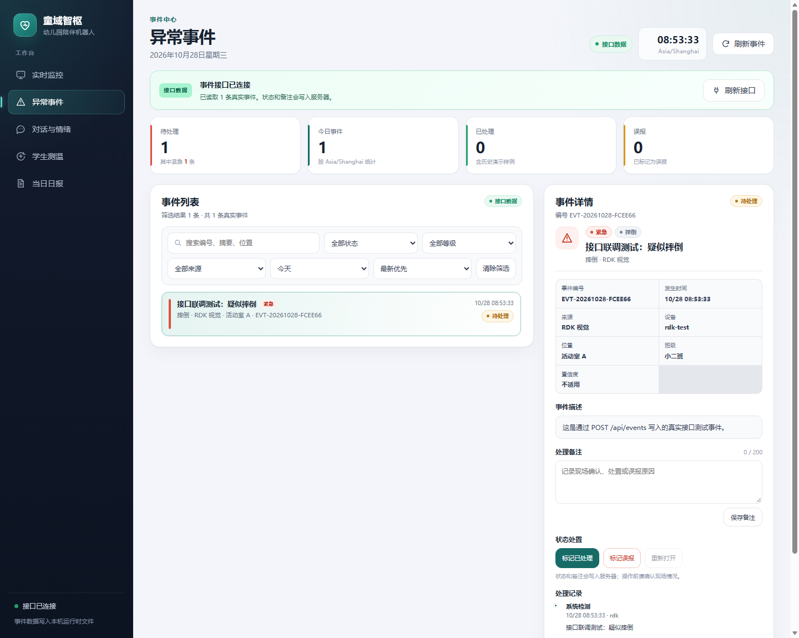
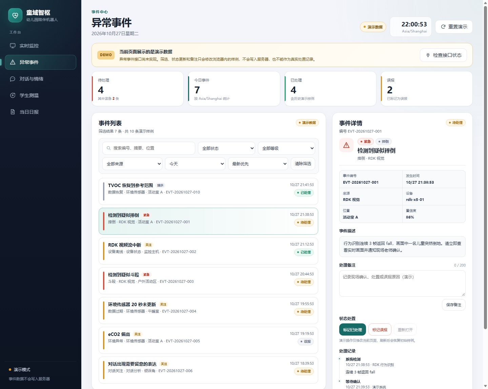
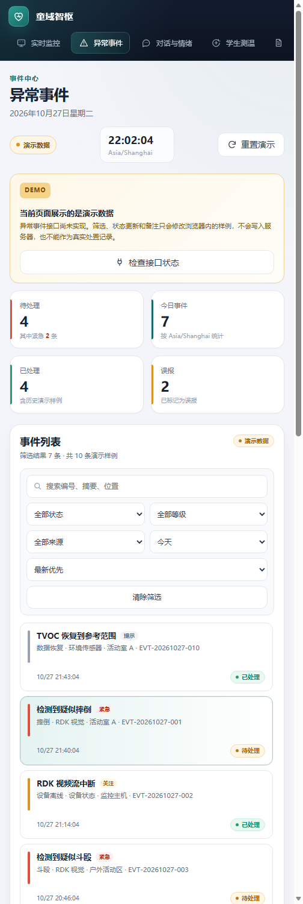

# 异常事件页面说明

更新日期：2026-11-04

负责页面：`dashboard/events.html`

## 页面目标

异常事件页用于集中查看、筛选和处置监控过程中产生的事件，包括摔倒、疑似斗殴、设备离线、传感器数据过期、环境异常和对话关注。页面与实时监控首页共用导航、青绿色主色、状态色和卡片样式。

异常事件接口已经实现：`GET /api/events` 查询、`POST /api/events` 写入、状态处置和备注都会访问服务端，并持久化到被 Git 忽略的 `dashboard/events.json`。页面启动时优先读取真实接口；接口返回 403/404/502 或网络超时时，才切换到带“演示数据”标识的固定样例。演示模式下的操作只修改浏览器内存，不会写入服务器。

## 页面结构

- 顶部导航：实时监控、异常事件、对话与情绪、学生测温、当日日报。
- 页面头部：Asia/Shanghai 时间、接口/演示模式标识、刷新按钮。
- 数据状态：接口已连接时显示绿色“接口数据”；接口不可用时显示黄色“演示数据”和错误原因。
- 统计卡片：待处理、今日事件、已处理、误报。
- 筛选栏：关键词、处理状态、事件等级、来源、日期范围和排序。
- 事件列表：等级、事件类型、来源、位置、时间和状态。
- 事件详情：编号、发生时间、来源、设备、位置、置信度、事件描述、处理备注、状态处置和处理记录。
- 空状态：筛选无结果时显示清除筛选入口。
- 接口读取：页面启动自动请求 `GET /api/events?limit=200&sort=newest`；接口不可用时保留演示数据和重试入口。

## 演示样例覆盖的状态

| 维度 | 取值 |
|---|---|
| 处理状态 | `pending` 待处理、`resolved` 已处理、`false_alarm` 误报 |
| 事件等级 | `urgent` 紧急、`watch` 关注、`info` 提示 |
| 事件来源 | `rdk`、`sensor`、`dialogue`、`device`、`manual` |
| 事件类型 | 摔倒、斗殴、设备离线、数据过期、环境异常、对话关注、数据恢复 |

## 统一事件数据字段

以下字段已经由 `dashboard/event_contract.py` 统一规范化。

| 字段 | 类型 | 说明 |
|---|---|---|
| `id` | string | 事件唯一编号，例如 `EVT-20261027-001` |
| `event_type` | string | `fall`、`fight`、`device_offline`、`sensor_expired`、`environment`、`dialogue_attention`、`sensor_recovered` |
| `level` | string | `urgent`、`watch`、`info` |
| `source` | string | `rdk`、`sensor`、`dialogue`、`device`、`manual` |
| `status` | string | `pending`、`resolved`、`false_alarm` |
| `occurred_at` | string | 带时区的 ISO 8601 时间 |
| `summary` | string | 列表和详情标题 |
| `detail` | string | 事件补充说明 |
| `device_id` | string | 产生事件的设备编号 |
| `class_id` | string | 班级编号，未知时为空 |
| `class_name` | string | 班级显示名，未知时显示“未分班” |
| `location` | string | 活动室、午睡室等位置 |
| `confidence` | number/null | 算法置信度，范围 `0`～`1`；非算法事件为 `null` |
| `handled_at` | string/null | 完成处置时间 |
| `handled_by` | string/null | 处置人显示名 |
| `note` | string | 当前处理备注，最多 200 字 |
| `dedupe_key` | string | 同一告警的去重键，可为空 |
| `history` | array | 处理记录，元素包含 `at`、`action`、`by`、`note` |
| `updated_at` | string | 最近一次更新时间 |

## 已实现接口与统一契约

### Issue 标题

```text
新增异常事件查询与处置接口
```

### 实现状态

接口已在 `dashboard/server.py` 实现，字段和枚举由 `dashboard/event_contract.py` 统一；事件页已接入真实数据，接口不可用时才使用演示数据。Issue #4 的实现记录应在 PR 合并后关闭。

### 查询接口

```text
GET /api/events
```

可选查询参数：

```text
status=pending|resolved|false_alarm
level=urgent|watch|info
source=rdk|sensor|dialogue|device|manual
date_from=YYYY-MM-DD
date_to=YYYY-MM-DD
q=关键词
sort=newest|oldest
limit=50
offset=0
```

成功响应：

```json
{
  "events": [
    {
      "id": "EVT-20261027-001",
      "event_type": "fall",
      "level": "urgent",
      "source": "rdk",
      "status": "pending",
      "occurred_at": "2026-10-27T09:42:10+08:00",
      "summary": "检测到疑似摔倒",
      "detail": "行为识别连续 3 帧返回 fall。",
      "device_id": "rdk-x5-01",
      "location": "活动室 A",
      "confidence": 0.86,
      "handled_at": null,
      "handled_by": null,
      "note": "",
      "history": [
        {
          "at": "2026-10-27T09:42:10+08:00",
          "action": "系统检测",
          "by": "RDK 行为识别",
          "note": "连续 3 帧返回 fall"
        }
      ]
    }
  ],
  "total": 1,
  "limit": 50,
  "offset": 0,
  "updated_at": "2026-10-27T09:42:11+08:00"
}
```

### 写入接口

```text
POST /api/events
```

请求至少包含：

```json
{
  "event_type": "fall",
  "level": "urgent",
  "source": "rdk",
  "occurred_at": "2026-10-28T09:42:10+08:00",
  "summary": "检测到疑似摔倒",
  "detail": "行为识别连续 3 帧返回 fall。",
  "device_id": "rdk-x5-01",
  "class_id": "C-02",
  "class_name": "小二班",
  "location": "活动室 A",
  "dedupe_key": "rdk-fall-20261028-094210"
}
```

相同 `dedupe_key` 重复写入返回原事件，不生成重复记录。

### 状态接口

```text
POST /api/events/{id}/status
```

请求：

```json
{
  "status": "resolved",
  "note": "现场确认儿童没有受伤。",
  "handled_by": "李老师"
}
```

允许的处置为 `resolved`、`false_alarm` 和重新打开时的 `pending`。`resolved` 和 `false_alarm` 必须写入 `handled_at` 与 `handled_by`。

### 备注接口

```text
POST /api/events/{id}/notes
```

请求：

```json
{
  "note": "已通知现场老师。",
  "author": "李老师"
}
```

备注最多 200 字，写入事件处理记录。

### 与日报的统一映射

日报使用不同的展示枚举，但不能直接假设事件库使用同一套值。统一映射为：

```text
urgent → high
watch  → medium
info   → low
resolved → handled
event_type → type
summary → title
handled_by → handler
```

映射函数位于 `dashboard/event_contract.py` 的 `event_for_report()`；后续 `/api/reports/daily` 应调用它，而不是自行复制一套枚举。

### 去重、存储和访问

- 事件写入时使用 `dedupe_key` 去重，避免行为识别每 3 秒轮询重复建事件。
- RDK `/alert_status` 从正常进入 `fall/fight` 时会自动写入事件；同一告警持续期间不会重复创建，恢复为正常后再次触发才会生成新事件。
- 传感器过期、环境异常、设备离线和对话关注等其他来源可通过 `POST /api/events` 由采集程序写入。
- 运行数据保存在 `dashboard/events.json`，已被 `.gitignore` 忽略，最多保留 2000 条。
- 事件接口只允许服务电脑本机访问；事件页在局域网访问时无法取得真实数据，会明确回退到演示模式。
- 所有时间使用带时区的 ISO 8601，业务日期按 Asia/Shanghai。

### 错误响应

所有错误使用 JSON：

```json
{
  "ok": false,
  "error": "event not found",
  "detail": "事件编号不存在"
}
```

建议状态码：参数错误 `400`，事件不存在 `404`，状态冲突 `409`，服务端错误 `500`。

### Issue 验收示例

1. `GET /api/events?status=pending` 只返回待处理事件，`total` 与筛选结果一致。
2. 按关键词、来源和日期范围筛选，结果符合预期。
3. 没有匹配事件时返回空 `events` 数组，页面显示空状态。
4. 将待处理事件标记为已处理或误报后，刷新页面状态仍然保留。
5. 重新打开后可再次处置，处理记录按时间顺序追加。
6. 备注超过 200 字返回 `400`，不写入数据。
7. 时间使用带时区的 ISO 8601，页面按 `Asia/Shanghai` 显示。
8. 接口失败时页面保留最后一次数据并显示错误原因，不出现整页空白。
9. 页面动态文字使用安全的文本渲染方式，不把接口内容直接拼接为 HTML。

## 验收演示步骤

1. 打开 `http://127.0.0.1:8088/events`。
2. 接口有数据时确认顶部显示绿色“接口数据”；接口不可用时确认黄色“演示数据”和错误原因。
3. 依次按状态、等级、来源、日期和关键词筛选。
4. 点击事件，查看等级、来源、时间、设备、班级和处理记录。
5. 输入备注并点击“保存备注”；接口模式确认写入服务器，演示模式确认出现演示提示。
6. 点击“标记已处理”“标记误报”和“重新打开”，确认状态、统计卡片和处理记录同步变化。
7. 点击“清除筛选”，确认列表恢复。
8. 点击“刷新接口”，确认页面重新读取 `/api/events`；接口失败时保留最后一次真实数据或明确回退演示。
9. 刷新页面，确认接口模式下的状态和备注仍然保留。
10. 将浏览器缩窄到手机宽度，确认筛选、列表和详情依次堆叠，没有横向溢出。

## 浏览器检查记录

| 场景 | 检查结果 |
|---|---|
| 桌面端 1440 px | 导航、统计卡片、筛选栏、事件列表和详情面板完整显示，没有横向滚动 |
| 手机宽度 504 px | 无头浏览器实际布局宽度；导航横向滚动，统计卡片两列，列表和详情纵向堆叠 |
| 待处理 / 已处理 / 误报 | 状态标签颜色和统计数量正确 |
| 紧急 / 关注 / 提示 | 列表左侧等级条、等级标签和详情图标对应正确 |
| 筛选无结果 | 显示空状态和“清除筛选”按钮 |
| 备注输入 | 计数不超过 200 字，保存后处理记录追加 |
| 状态处置 | 已处理、误报和重新打开按钮的禁用状态正确 |
| 真实接口模式 | 通过 `POST /api/events` 写入测试事件后，页面显示绿色“接口数据”、1 条真实事件和班级信息 |
| 接口不可用回退 | 403/404/502/超时时显示黄色“演示数据”和错误原因，不伪装成真实数据 |
| 动态文字安全 | 事件摘要、描述、备注和处理记录均通过 `textContent` 写入 |
| 键盘与焦点 | 事件行可用 Tab 聚焦，按钮有可见焦点样式 |

说明：`tests/test_event_contract.py` 和 `tests/test_events.py` 共 11 项测试通过，覆盖 B/C 映射、创建、去重、筛选、状态转换、备注、错误参数、证据字段、受保护证据图片路由、持久化和 RDK 告警自动入库；事件页真实接口模式已用本机服务器和测试事件验证。`tests/test_monitor_events_ux.py` 另行检查本轮 UX 控件、关键脚本、告警跳转和 DOM 引用完整性。

页面同时实现了 `<= 560 px` 和 `<= 380 px` 的窄屏断点；建议在真实手机或浏览器设备模式下再复查一次 390 px 宽度。

## 页面截图

第一张为真实接口联调截图（测试事件），后两张为演示模式截图。







## 当前限制

- 事件接口只允许本机访问；局域网打开页面时会回退到演示数据。
- RDK 的 fall/fight 告警已自动入库；传感器、环境和对话等其他来源仍需采集程序调用 `POST /api/events` 并提供稳定的 `dedupe_key`。
- C 的 `/api/reports/daily` 已实现，并使用 `event_for_report()` 做统一映射；后续修改必须保持该映射。
- 当前事件存储是单机 JSON 文件，未实现多用户并发编辑和完整审计权限。

## 监控与事件 UX 改进（2026-11-04）

本轮在原事件页和监控首页上完成以下改进：

1. **自动刷新与新事件提示**：事件页每 5 秒静默读取
   `GET /api/events?limit=200&sort=newest`。后台刷新不会反复切换到“检查中”，
   并保留当前筛选、排序、选中事件和键盘焦点。检测到新事件 ID 时显示“收到
   N 条新事件”和“查看新增”按钮；页面隐藏时暂停轮询，重新显示时立即刷新。
2. **角色权限**：管理员可保存备注、标记已处理、误报或重新打开；普通用户只读，
   整块备注和状态处置区隐藏，并显示只读说明。服务端仍执行管理员和 CSRF 校验，
   前端隐藏不是唯一安全边界。
3. **监控告警跳转事件**：监控首页出现红色摔倒或疑似斗殴告警时，状态横幅显示
   “查看待处理事件”，跳转到
   `/events.html?status=pending&level=urgent&date=all&open=1`；事件页读取查询参数、
   应用筛选，并在窄屏直接打开命中事件的详情。
4. **事件证据画面**：详情页增加证据区域，可显示事件证据图片和采集时间。接口新增
   `evidence_url` 与 `evidence_captured_at`；前端和服务端均只接受同源路径或
   PNG/JPEG/WebP/GIF data URL，拒绝任意外链和 SVG data URL。没有证据时显示明确空状态。
   `dashboard/evidence/` 作为被 Git 忽略的运行时目录，通过受事件模块权限保护的
   `/evidence/<文件名>` 读取。真实儿童画面不得提交到 Git。
5. **待处理超时提醒**：`pending` 事件超过 5 分钟会在列表显示“超时”，统计卡显示超时数量，
   详情显示“待处理 N 分钟 · 已超过 5 分钟”。该时间基于事件 `occurred_at`，不是页面刷新时间。
6. **筛选、键盘和移动端详情**：增加“今日全部、全部待处理、紧急待处理、已超时”快捷筛选；
   `/` 聚焦搜索，`j`/`k` 切换上一条或下一条事件，`Escape` 返回列表或清空搜索。
   在 `<=1180px` 屏幕点击事件后切换到详情，提供“返回事件列表”按钮，避免列表和详情长距离堆叠。

### 证据字段约束

| 字段 | 类型 | 说明 |
|---|---|---|
| `evidence_url` | string | 可选；同源绝对路径或 PNG/JPEG/WebP/GIF data URL |
| `evidence_captured_at` | string/null | 可选；ISO 8601 证据采集时间 |

示例：

```json
{
  "evidence_url": "/evidence/EVT-20261028-ABC123.png",
  "evidence_captured_at": "2026-10-28T09:42:10+08:00"
}
```

### 本轮验收重点

- 等待 5 秒并写入一条新事件，确认列表出现“新”标记和新事件提示，当前筛选与选中项不丢失。
- 同时用管理员和普通用户打开事件页，确认普通用户看不到处置按钮，直接调用写接口仍被服务端拒绝。
- 在监控首页制造 fall/fight 红色告警，确认“查看待处理事件”进入紧急待处理筛选。
- 带合法 `evidence_url` 写入事件并打开详情；再提交外链或 SVG data URL，确认接口返回 400。
- 打开 6 分钟前的 `pending` 事件，确认列表、统计卡和详情均显示超时。
- 用 `/`、`j`、`k`、`Escape` 操作键盘，并在窄屏点击事件后使用“返回事件列表”。

页面结构、接口和自动刷新逻辑已完成；真实 RDK 告警、摄像头证据和不同网络延迟下的
端到端表现仍需在接入设备后复测，不能仅用演示数据替代现场验收。

## 告警自动截图（2026-11-04）

RDK 行为告警自动入库的同时，Dashboard 会在后台线程从 RDK 的
`/video_feed` 抓取一帧 JPEG 作为事件证据：

- 只有从正常状态进入 `fall`/`fight` 的**新事件**才抓取；同一告警持续期间
  不重复抓取，恢复正常后再次告警才重新抓取，与事件去重节奏一致。
- 证据写入被 Git 忽略的 `dashboard/evidence/<事件编号>.jpg`，事件记录保存
  `evidence_url` 与 `evidence_captured_at`，处理记录追加“自动截图”。
- 抓取在后台线程执行（默认最长 6 秒，`EVIDENCE_CAPTURE_TIMEOUT` 可调），
  不会拖慢监控页对 `/api/rdk/status` 的轮询；失败时事件照常入库，只是没有
  证据画面，详情页显示空状态。
- 真实儿童画面不得提交到 Git；`dashboard/evidence/` 已被 `.gitignore` 忽略。

### 验收步骤

1. 保持 RDK `/video_feed` 可用，令 `/alert_status` 从正常进入 `fall`（或 `fight`）。
2. 打开 `/events`，新事件详情出现证据画面与“证据时间”，处理记录含“自动截图”。
3. 令告警持续 30 秒，确认不会反复生成事件或覆盖证据。
4. 停止 RDK 视频流后再次制造告警，确认事件仍入库、证据区域显示空状态。
5. 设置 `EVIDENCE_AUTO_CAPTURE=0` 重启，确认不再生成证据文件。
