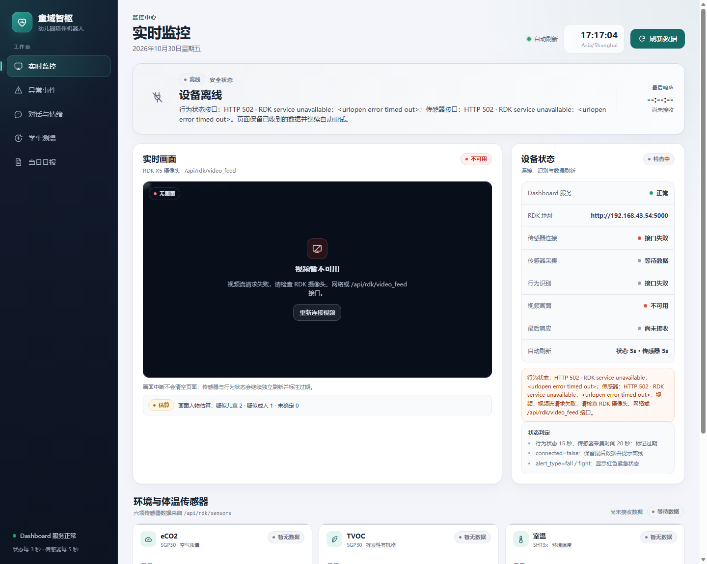

# 课堂演示：疑似成人/儿童画面估算

更新日期：2026-10-30

## 目标与边界

本演示在监控画面中增加一层**姿态比例估算**：

```text
疑似儿童 / 疑似成人 / 未知
```

它使用 YOLOv8 Pose 的头部、肩部、髋部和脚踝关键点，计算头身比例，并对同一轨迹的多帧结果做投票。结果写入本机 `dashboard/person_types.json`，实时监控页读取后显示人数。

这不是年龄识别，也不是身份识别：

- 不识别具体学生或教师；
- 不判断真实年龄；
- 不根据结果做自动处罚或安全决策；
- 结果必须由现场老师复核；
- 远景、坐姿、遮挡、摄像头角度会显著影响估算。

## 文件

| 文件 | 作用 |
|---|---|
| `dashboard/person_type.py` | 头身比例、多帧投票和人数汇总规则 |
| `scripts/person_type_demo.py` | 读取视频流、运行 YOLOv8 Pose、绘制标签并写 JSON |
| `scripts/requirements-person-type.txt` | 演示额外依赖 |
| `dashboard/person_types.json` | 运行时结果，已被 Git 忽略 |

## 安装依赖

在仓库根目录执行：

```powershell
cd "C:\Users\lenovo\Desktop\童域智枢-源码参考净化包\tongyu-zhishu"
python -m pip install -r scripts\requirements-person-type.txt
```

首次运行需要 `yolov8n-pose.pt`。可以提前放到当前目录，或让 Ultralytics 在联网时自动下载。

## 启动顺序

### 1. 启动 Dashboard

```powershell
cd dashboard
$env:RDK_BASE = "http://你的RDK实际IP:5000"
python server.py
```

### 2. 另开终端启动人物估算

读取 RDK 视频流：

```powershell
cd "C:\Users\lenovo\Desktop\童域智枢-源码参考净化包\tongyu-zhishu"
python scripts\person_type_demo.py --source "http://你的RDK实际IP:5000/video_feed" --output dashboard\person_types.json
```

使用电脑摄像头：

```powershell
python scripts\person_type_demo.py --source 0 --output dashboard\person_types.json
```

无桌面窗口的 RDK/服务器运行：

```powershell
python scripts\person_type_demo.py --source "http://你的RDK实际IP:5000/video_feed" --no-show
```

### 3. 打开监控首页

```text
http://127.0.0.1:8088/
```

画面下方会出现类似：

```text
估算  画面人物估算：疑似儿童 2 · 疑似成人 1 · 未确定 0
```

页面对数据来源标注“估算”，不会把它显示成身份结论。



## 结果 JSON

```json
{
  "estimate": true,
  "generated_at": "2026-10-30T15:55:00+08:00",
  "disclaimer": "疑似成人/儿童为课堂演示估算，不是年龄或身份识别，需人工复核。",
  "source": "http://192.168.43.54:5000/video_feed",
  "counts": {"adult": 1, "child": 2, "unknown": 0, "total": 3},
  "persons": [
    {
      "person_id": "7",
      "person_type": "child",
      "confidence": 0.82,
      "head_ratio": 0.168,
      "bbox": [120, 80, 260, 420]
    }
  ]
}
```

## 阈值校准

默认规则：

```text
head_ratio >= 0.155 → 疑似儿童
head_ratio <= 0.135 → 疑似成人
中间区间 → 未知
```

摄像头高度、俯仰角和人物距离会改变比例。课堂演示前应使用现场已知成人/儿童站位检查一遍，并按需要调整：

```powershell
python scripts\person_type_demo.py `
  --source "http://RDK_IP:5000/video_feed" `
  --child-threshold 0.16 `
  --adult-threshold 0.13
```

不要把阈值调得过度自信；不确定时应保留“未知”。

## 课堂演示流程

1. 启动 Dashboard 和人物估算脚本。
2. 先让一位成人站在固定距离，观察是否标记为“疑似成人”。
3. 再让一位儿童站在同一位置，观察是否标记为“疑似儿童”。
4. 观察监控页的估算人数变化。
5. 展示坐姿、遮挡或远景时的“未知”结果，说明这只是一个辅助估算。
6. 强调结果需要现场老师复核，不用于自动判断身份或年龄。

## 隐私和限制

- 不保存人脸、姓名或学生身份，只保存轨迹编号、类型、置信度和画面框。
- `dashboard/person_types.json` 已被 Git 忽略，不提交运行结果。
- 不要把真实儿童画面、训练数据或模型文件提交到 Git。
- 需要稳定识别时，应训练成人/儿童分类器，并使用多人跟踪和多帧投票。
- 单帧、远景、遮挡、只拍到上半身时，结果很可能是“未知”。
