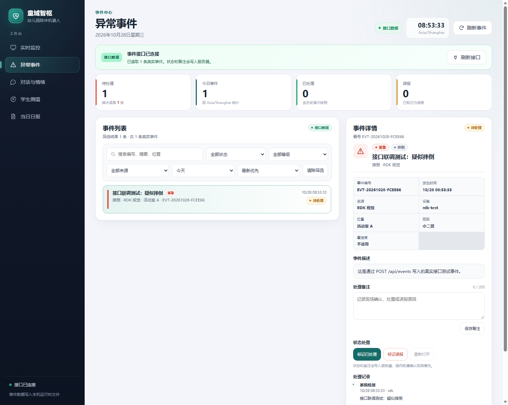
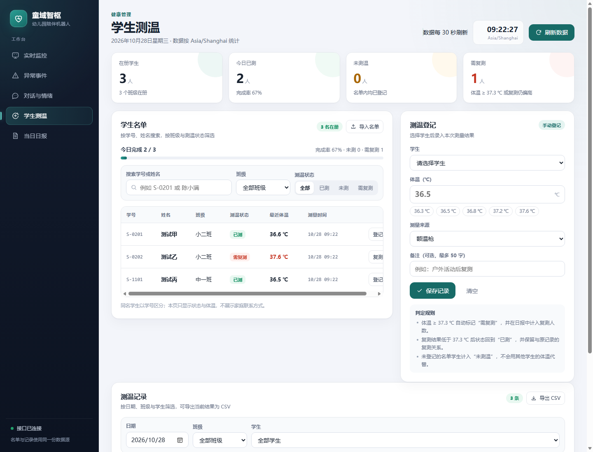
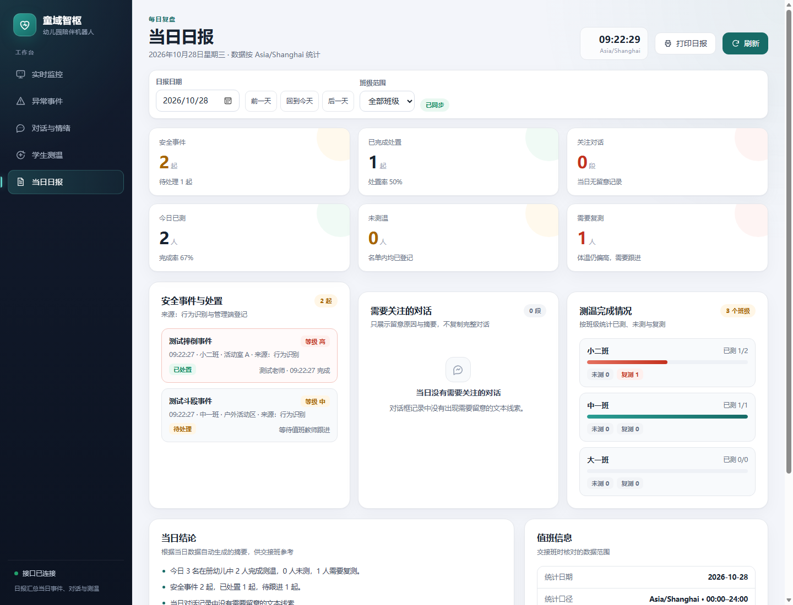

# 用户手册

更新日期：2026-11-05

本手册面向答辩演示和日常使用，按角色说明入口、操作步骤和注意事项。技术细节见
[API 文档](API.md)、[架构说明](ARCHITECTURE.md)。

## 1. 角色与入口

| 角色 | 登录后入口 | 可做什么 |
|---|---|---|
| 管理员 | `/admin`（展示设置） | 全部模块、账号管理、事件处置、名单导入、体温登记 |
| 演示账号 | `/welcome` | 按管理员开放的模块只读浏览 |
| 家长 | `/family-events.html` | 查看绑定孩子的安全事件、日报与授权截图 |
| 商家 | `/sensors.html` | 查看环境传感器读数 |
| 待分配账号 | `/welcome` | 等待管理员分配角色 |

首次启动由电脑终端创建管理员；浏览器注册的账号默认进入“待分配”。

## 2. 首次启动

```powershell
py -3.10 -m venv .venv
.\.venv\Scripts\python.exe -m pip install -r tests\requirements.txt
$env:RDK_BASE = "http://192.168.43.54:5000"
.\.venv\Scripts\python.exe scripts\run_dashboard.py
```

打开 <http://127.0.0.1:8088/login>，按终端提示创建管理员。没有 RDK 时可用
`python scripts/mock_rdk.py --port 5000` 模拟设备。

## 3. 页面操作

### 3.1 实时监控 `/`



- 左侧视频、右侧传感器读数；顶部显示设备连接与采集时间；
- 红色告警（摔倒/斗殴）时点击“查看待处理事件”跳转事件页；
- 过期/离线会明确标识，不会显示为正常。

### 3.2 异常事件 `/events`

- 列表每 5 秒刷新，新事件有“新”标记；支持状态、等级、来源、日期、关键词筛选；
- 点击事件查看详情、证据图、处理记录；
- 管理员操作：保存备注、标记已处理/误报、重新打开；
- 摔倒事件选择 1 名学生，斗殴选择至少 2 名；同名用 `姓名@学号`；
- 抓拍失败显示原因，可点“重新抓拍证据”；
- 关联学生后，家长端可见该事件（需管理员开放截图权限）。

### 3.3 家长端 `/family-events.html`

- 用家长账号登录，自动进入家长工作台；
- 只看绑定孩子的事件与日报；多人事件只显示自己孩子；
- 截图需老师关联事件且账号有截图权限；无权限时显示空状态。

### 3.4 学生测温 `/health.html`



1. 导入名单（CSV/TXT，至少包含学号、姓名、班级）；
2. 选择学生，确认实时红外温度或手动输入并选择测量来源；
3. 体温偏高可标记复测；按日期/班级/学生筛选；
4. “导出 CSV”保存当前筛选结果。

### 3.5 当日日报 `/reports.html`



- 选择日期与班级，查看事件处置、关注对话、测温完成/复测、体温趋势；
- “打印”可另存 PDF；
- 家长日报在家长工作台按孩子查询。

### 3.6 对话与情绪 `/chat`

- 按日期、设备、会话筛选最近 200 条消息；
- 显示情绪标签、关注等级和来源；管理员可修改界面与模型配置；
- 管理员可删除当前会话或清空对话；可把消息关联到孩子供家长日报查看。

### 3.7 账号管理 `/admin`

- 展示设置：开放五个模块、摄像头、对话原文；
- 已注册账号：分配家长/商家/演示/待分配角色；家长需绑定 1–20 名学生；
- 家长账号可设置事件、截图、日报、对话四项权限。

## 4. 常见问题

| 问题 | 处理 |
|---|---|
| 页面提示“接口不可用” | 检查 Dashboard 是否启动、RDK 地址与网络 |
| 看不到视频 | 管理员在展示设置中开放摄像头；确认 RDK `/video_feed` |
| 事件没有截图 | RDK `/snapshot` 不可用；事件页显示原因，可重试 |
| 家长看不到事件 | 老师未关联学生、事件为误报、或家长未绑定该学生 |
| 体温登记失败 | 学号必须先在名单中；温度 35–42 ℃ |
| 设备推送 503 | 未配置 `HEALTH_DEVICE_TOKEN`（至少 24 位） |
| 手机打不开 | 使用 cloudflared 临时链接，见 `docs/MOBILE_DEMO.md` |

## 5. 数据与隐私

- 名单、体温、对话、抓拍和账号只保存在运行网页的电脑；
- 运行数据被 Git 忽略，不会上传仓库；
- 演示前请使用模拟或脱敏数据，结束后清理真实记录；
- 家长端只显示本人孩子；发现越权请联系管理员。
