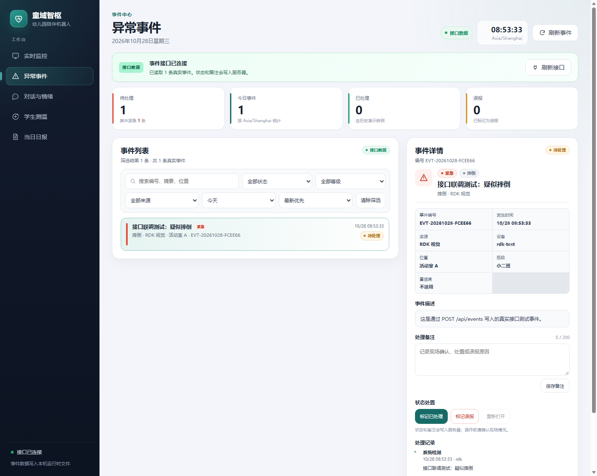

# 验证记录

最近更新：2026-10-28。

- 7 项隔离自动化测试通过：监控/对话页面及 RDK JSON 代理路由、界面配置保存与校验、消息持久化、访问限制、重复消息和 200 条上限、生产 STT/TTS 入口到 HTTP 接收的顺序、转发故障不阻塞及恢复。
- 实际浏览器检查对话文字与用户/机器人标识，设备筛选生效，HTML 字样作为普通文本呈现；基础监控页的页面结构和接口错误展示符合预期。
- 本地运行依赖、FFmpeg、配置及模型文件清单检查通过。检查终端显式加入了现有 Conda 环境的 Library/bin 路径；日常启动需要先激活环境。
- 使用现有本机模型配置与儿童陪伴提示词发起一次独立的连通测试，DeepSeek `deepseek-chat` 成功返回文字。测试未使用真实儿童对话。
- 新增 GitHub Actions 配置，每次 push / pull request 运行隔离测试和待提交源码检查。
- 初始提交 `c499217` 已上传私人仓库，GitHub Actions 检查成功；远端文件清单确认不包含私有配置与模型。

自动化测试和浏览器预览使用隔离数据，不保存到实际运行目录。真实密钥和本地模型由 Git 忽略；初始提交前另行比对本机真实密钥，检查暂存清单。

## 监控页异常状态修复（2026-10-27）

- 同时出现 `alert_type=fall/fight` 和 `connected=false` 时，顶部保留红色紧急告警，并额外显示“传感器断开”标签；不再被灰色“设备离线”覆盖。
- 传感器页改为优先使用接口返回的采集时间 `timestamp` 判断是否超过 20 秒，不再把“刚刚收到响应”当作“刚刚采集”。
- 采集时间超过阈值显示“数据已过期”；未提供显示“数据时间未知 / 采集时间未知”；格式错误显示“采集时间异常”。三种情况都不会显示绿色“数据正常”。
- 页面兼容根节点或 `properties` 下的 `timestamp`、`ts`、`updated_at`、`collected_at` 等常见字段；推荐接口统一返回带时区的 ISO 8601 `timestamp`。
- `/events` 和 `/events.html` 路由测试通过。更新代码后必须重启 `python server.py`，旧进程不会加载新增页面路由。

浏览器检查截图：

- [摔倒告警与传感器断开同时出现](assets/monitor-fall-sensor-offline.png)
- [传感器采集时间为 1 小时前](assets/monitor-sensor-expired.png)
- [传感器接口未提供采集时间](assets/monitor-sensor-time-unknown.png)

检查覆盖 1440 px 桌面布局，并确认事件页在最新代码中可通过 `/events` 打开。真实硬件采集时间字段仍需在实际 `/api/iot_payload` 返回中确认。

## 异常事件接口（2026-10-28）

- 新增 `dashboard/event_contract.py`，统一事件字段、等级/状态枚举和 B/C 日报映射；`urgent/watch/info` 映射为日报的 `high/medium/low`，`resolved` 映射为 `handled`。
- 新增 `GET /api/events`、`GET /api/events/{id}`、`POST /api/events`、状态处置和备注接口，事件运行数据写入被 Git 忽略的 `dashboard/events.json`。
- 使用 `dedupe_key` 防止同一告警重复入库；默认最多保留 2000 条。
- `tests/test_event_contract.py` 与 `tests/test_events.py` 共 7 项测试通过，覆盖映射、创建、去重、筛选、状态转换、备注、参数错误和持久化。
- 事件页真实接口模式已通过本机 Dashboard 写入测试事件验证，页面显示绿色“接口数据”和真实事件；“接口不可用时回退到演示数据”的行为保留。

## 先期设备联调记录

团队此前使用实际设备完成过接口联调，并确认以下数据能够传到服务端且按约定字段接收：

- RDK 的 `/video_feed` 视频流和 `/alert_status` 行为状态。
- STM32 经 `/api/iot_payload` 提供的连接状态、红外目标/环境温度、环境温湿度、eCO₂ 和 TVOC 数据。
- ESP32 到小智语音服务的 WebSocket 会话，以及用户识别文字和助手回复到 Dashboard 的消息链路。

这部分是团队提供的先期人工联调结论，作为 V1 网页开发的接口基线；本轮仓库自动化测试没有重新连接硬件复测。该结论只说明传输、接收和字段解析成功，不用于证明传感器测量精度、视觉算法准确率或所有网络环境的稳定性。

本记录验证本仓库内的网页和服务端软件。RDK 视觉识别、STM32 数据采集、ESP32 固件和机器人控制属于外部模块，不在本仓库隔离测试范围。全新电脑的依赖安装流程尚未单独复测。

对话页显示软件入口收到的消息并按句展示，最近 200 条消息保存在本机运行时文件中；网页服务未启动或发送队列已满时，对应消息不会进入记录。该记录用于课堂演示和运行查看，不构成完整的模型调用审计系统。
